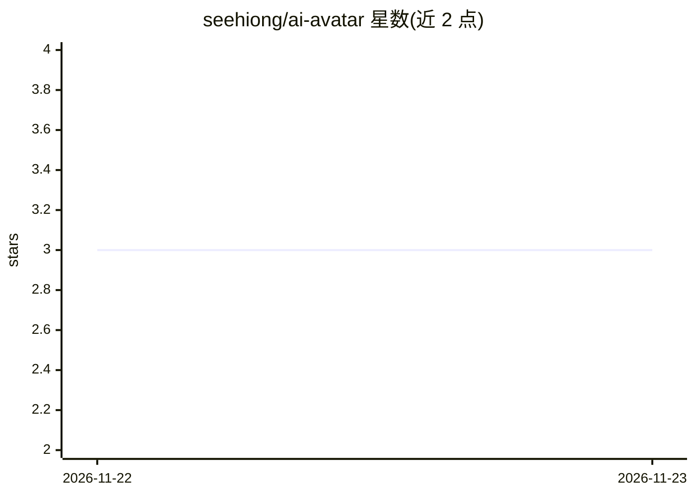

# seehiong/ai-avatar

⭐ 3 · Python · NOASSERTION · 推送 2026-11-15 · [GitHub](https://github.com/seehiong/ai-avatar) · [官网](https://seehiong.github.io/ai-avatar/) · 个人维护

**基于简历与职位描述的本地实时 3D 头像 AI 模拟面试官**

视频通话风格的口语模拟面试应用：3D 动画头像（或本地 GPU 上的照片级人脸）以语音进行面试，内容基于用户简历与 JD，结束后按量规评分并生成可下载的反馈报告。提供两种引擎：本地服务器为完整版（Python 3.10+ 与 Ollama，含 STT/LLM/TTS 与神经口型同步）；浏览器引擎为实验性（WebLLM/Whisper/Kokoro 运行于 WebGPU，首次需下载约 1.5 GB 模型）。数据仅存于浏览器本地，麦克风需 localhost 或 HTTPS。

## 筛选速览

| 维度 | 判定 | 备注 |
|---|---|---|
| AI 角色 | `ai-native` | 本体是模型或模型工具 |
| 许可风险 | `none` | NOASSERTION |
| 部署形态 | `None` |  |
| 模型依赖 | local-ok | 支持本地模型 |
| 硬件要求 | — | 无带数字的原话,不猜 |
| 安装摩擦 | `high` | 编译与系统依赖俱全 |
| 成熟度 | — | 结构信号不足 |

## 能力要点

- 基于简历与 JD 的口语面试，带引用核对的量规评分与反馈报告
- 三种头像：照片级（LivePortrait+MuseTalk）、MPFB、Unreal MetaHuman，含协同发音口型与逐句情绪标签
- 双引擎：本地服务器（Ollama 30B 默认）或纯浏览器 WebGPU（Qwen2.5-1.5B via WebLLM）
- 开放麦克风打断、未说完保持、静音提示与历史面试弱点自适应

## 适用场景

- 求职前对着 AI 面试官做口语模拟面试练习
- 根据 JD 和简历获得针对性追问与评分反馈
- 查看 AI 候选人示范回答作为参考答案库

## 场景标签

`语音 Agent` · 领域:对话与助手

## 证据(README 行号)

> L3: A video-call style AI interviewer: a talking 3D head (or a photoreal face) that holds a spoken mock interview
> L4: grounded in your resume and a job description, then scores you against a rubric. Everything runs locally, either
> L52: |Interviewer model|Ollama, 30B by default|Qwen2.5-1.5B via WebLLM (`?llm=<id>` to change)|
> L134: |`web/browser-engine.js`|In-browser engine: Silero VAD, Whisper, WebLLM and Kokoro on WebGPU.|

## 星数曲线

2026-11-22 3 → 2026-11-23 3（+0）

---
*卡片 v1 · prompt 1.4 · 生成 2026-11-22 · 置信度 high · 依据 README sha `b9a956a2f8ae` · [字段定义](../../DATASET.md)*
