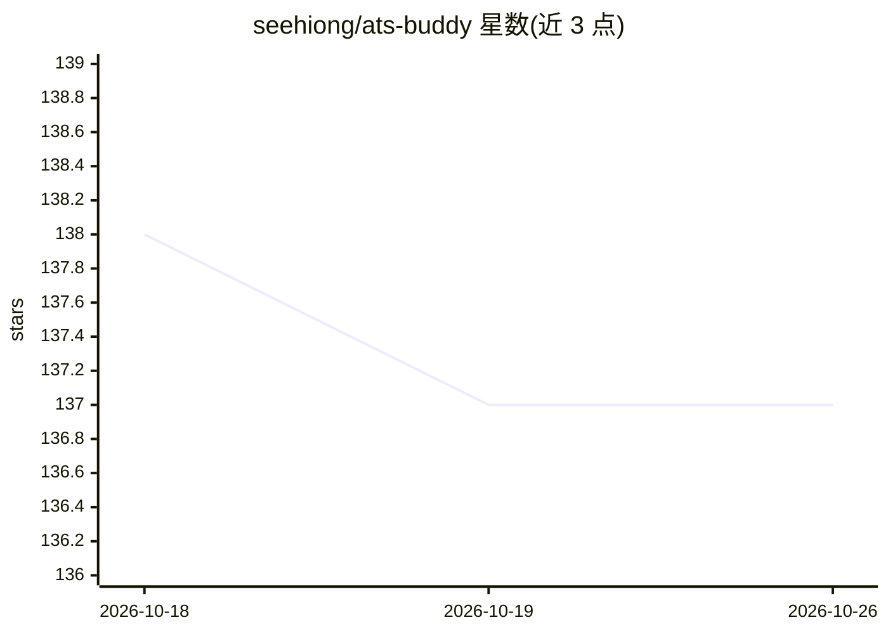

# seehiong/ats-buddy

⭐ 137 · TypeScript · MIT · 推送 2026-08-10 · [GitHub](https://github.com/seehiong/ats-buddy) · [官网](https://seehiong.github.io/ats-buddy/) · 个人维护

**本地运行的 ATS 简历匹配分析器：打分、关键词差距与改写**

浏览器端简历分析应用：读取简历 PDF 与职位描述，由本地模型输出匹配分数、缺失关键词（技术/软技能区分）、基于简历原文的改进建议、求职信与改写简历；扫描件经本地视觉模型 OCR。模型可走本机 Ollama 或浏览器内 WebLLM（需 WebGPU，不支持手机/平板），全程不上传。带缓存、历史清除、Markdown/HTML 报告导出与示例样本；从源码 npm 运行，无安装包。

## 筛选速览

| 维度 | 判定 | 备注 |
|---|---|---|
| AI 角色 | `ai-native` | 本体是模型或模型工具 |
| 许可风险 | `permissive` | MIT |
| 部署形态 | `library` | 以包/库形式分发 |
| 模型依赖 | local-ok | 支持本地模型 |
| 硬件要求 | — | 无带数字的原话,不猜 |
| 安装摩擦 | `low` | 无编译、无系统依赖或容器化 |
| 成熟度 | — | 结构信号不足 |

## 能力要点

- 匹配分数与缺失关键词（技术/软技能分类）输出
- 本地 Ollama 或浏览器内 WebLLM 双后端，数据不出本机
- 扫描 PDF 由本地视觉模型 OCR 读取
- 针对本地模型输出做防御式 JSON 解析与重试

## 适用场景

- 投递前对照职位描述检查简历差距并改写
- 敏感简历不做云端上传的本地化分析
- 验证扫描版简历经 OCR 后的匹配评估

## 场景标签

`OCR` `AI 写作` · 领域:内容生成

## 证据(README 行号)

> L3: Compare your resume against a job description and get back a match score, the keywords you're missing, and a rewritt
> L11: ATS Buddy runs the model on your hardware. Your resume is read in the browser, analysed by a model on your own mach
> L17: 1. **Choose where it runs** — local Ollama, or a model in the browser.

## 星数曲线

2026-10-18 138 → 2026-10-26 137（-1）

---
*卡片 v1 · prompt 1.4 · 生成 2026-10-22 · 置信度 high · 依据 README sha `6cdd610bd597` · [字段定义](../../DATASET.md)*
