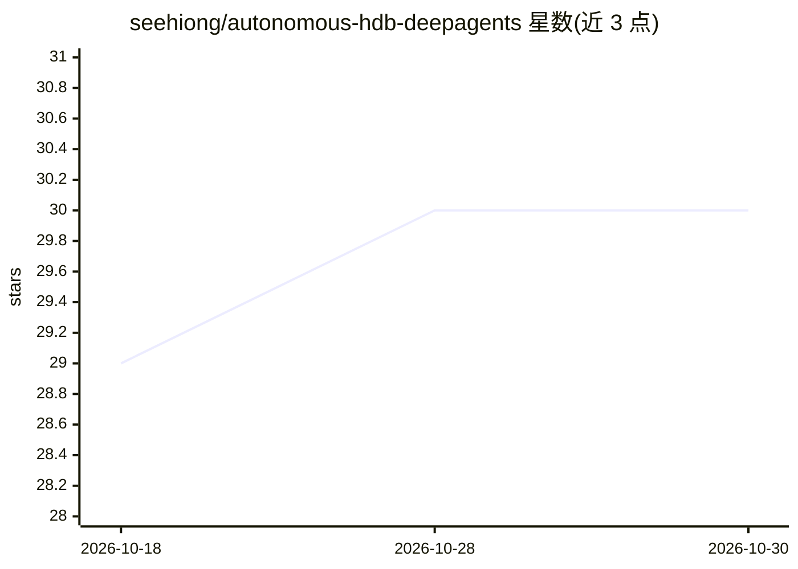

# seehiong/autonomous-hdb-deepagents

⭐ 30 · Python · MIT · 推送 2026-09-19 · [GitHub](https://github.com/seehiong/autonomous-hdb-deepagents) · [官网](https://seehiong.github.io/posts/2026/09/revamping-autonomous-hdb-agents/) · 个人维护

**新加坡 HDB 转售房搜索的多智能体系统：地理分析+XGBoost 估值**

基于 DeepAgents + LangGraph 的端到端流水线：把自然语言查询（镇区、MRT 站、房型、预算、半径）依次经过意图抽取、MRT 解析、转售房源检索、地理空间增强（最近 MRT/公园/步行性）、XGBoost 价格估值与 LLM 文字总结。所有数字在 Python 中渲染，模型只写解释性文字。无数据库，直接读取仓库内种子 CSV（SQLite 标准库做关系查询），LLM 端点可接 OpenRouter 或本地 llama-server。提供 CLI、FastAPI、Gradio 三种入口，支持 Docker 运行与发布镜像。面向关注新加坡 HDB 市场的终端用户与开发者。

## 筛选速览

| 维度 | 判定 | 备注 |
|---|---|---|
| AI 角色 | `ai-native` | 本体是模型或模型工具 |
| 许可风险 | `permissive` | MIT |
| 部署形态 | `self-host` | docker 或自建部署 |
| 模型依赖 | local-ok | 支持本地模型 |
| 硬件要求 | — | 无带数字的原话,不猜 |
| 安装摩擦 | `low` | 无编译、无系统依赖或容器化 |
| 成熟度 | — | 结构信号不足 |

## 能力要点

- 六节点 LangGraph 流水线：意图→MRT解析→检索→地理增强→估值→总结
- 无数据库设计：直接读种子 CSV，SQLite 标准库做关系查询
- 所有数字由 Python 渲染，LLM 仅写解释文字，量化模型不参与转录
- 可复现的数据摄取 notebook 覆盖 data.gov.sg/LTA/MOE/NParks/OneMap 官方数据源

## 适用场景

- 用自然语言搜索特定预算和 MRT 距离内的新加坡 HDB 房源
- 获得结合地理空间数据与 XGBoost 估值的选房建议
- 从官方数据源重建数据集或本地部署查询服务

## 场景标签

`多智能体` `数据分析` · 领域:Agent 开发

## 证据(README 行号)

> L5: This project provides an **autonomous DeepAgent pipeline** that processes natural-language queries like:
> L154: intent → mrt_resolve → resale → mrt → valuation → summary → END
> L144: LLM produces:

## 星数曲线

2026-10-18 29 → 2026-10-30 30（+1）

---
*卡片 v1 · prompt 1.4 · 生成 2026-10-26 · 置信度 mid · 依据 README sha `0c9073de46a8` · [字段定义](../../DATASET.md)*
