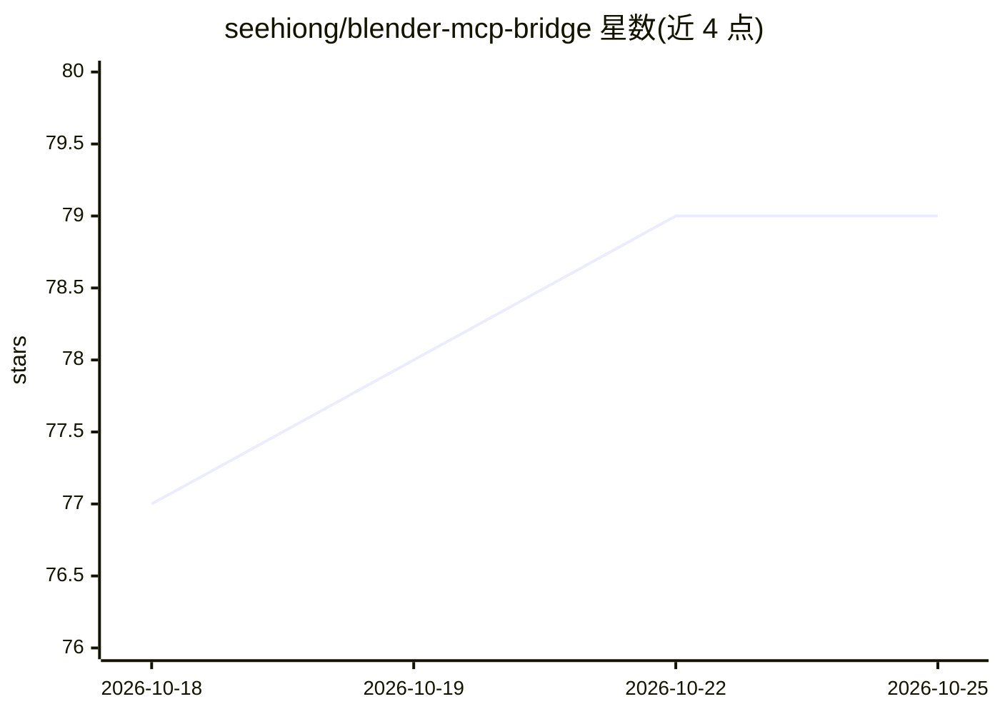

# seehiong/blender-mcp-bridge

⭐ 79 · Python · MIT · 推送 2026-09-13 · [GitHub](https://github.com/seehiong/blender-mcp-bridge) · [官网](https://seehiong.github.io/blender-mcp-bridge/) · 个人维护

**让 AI agent 通过 MCP 远程操控 Blender 建模的桥接服务器与插件**

由两部分组成：安装在 Blender 内的插件负责实际操作 3D 场景；独立的 Python MCP Bridge Server 作为网关，把 MCP 客户端（Claude Desktop、Claude Code、n8n 等）的命令经本地 TCP 转发给插件，暴露约 98 个工具，覆盖建模、雕刻、材质、建筑/MEP 与 3D 打印前检查。内置设计规则知识库（纯 JSON、无 LLM 调用）与多色 3D 打印纹理管线；支持会话录制/回放、Studio 可视化编辑器及带多 provider 的 AI 助手面板。3D 打印工具需 Blender 4.2+。

## 筛选速览

| 维度 | 判定 | 备注 |
|---|---|---|
| AI 角色 | `ai-ecosystem` | LLM/agent 周边工具 |
| 许可风险 | `permissive` | MIT |
| 部署形态 | `library` | 以包/库形式分发 |
| 模型依赖 | locked-api |  |
| 硬件要求 | — | 无带数字的原话,不猜 |
| 安装摩擦 | `low` | 无编译、无系统依赖或容器化 |
| 成熟度 | — | 结构信号不足 |

## 能力要点

- 98 个 MCP 工具覆盖建模、材质、渲染、建筑/MEP 与 3D 打印检查
- 设计规则知识库纯 JSON 查询，无 LLM/网络调用，毫秒级返回
- 会话录制与回放，支持参数化与分支
- 参考图引导的多色 3D 打印纹理管线，可直接导出 3MF 多材质文件

## 适用场景

- 让 Claude 或 n8n 中的 agent 直接在 Blender 里建模并检查可打印性
- 录制 AI 的工具调用序列形成宏，之后一键回放复现场景
- 为多色 3D 打印自动从参考图生成着色与 3MF 导出

## 场景标签

 · 领域:3D 建模/自动化工具

## 证据(README 行号)

> L22: 2. **MCP Bridge Server**: a standalone Python server (`blender_mcp_bridge/`) that acts
> L28:     Client[Claude / n8n / any MCP client] -- "MCP (HTTP Streamable)" --> Bridge[MCP Bridge Server]

## 星数曲线

2026-10-18 77 → 2026-10-25 79（+2）

---
*卡片 v1 · prompt 1.4 · 生成 2026-10-24 · 置信度 mid · 依据 README sha `3fcbeb0e8f76` · [字段定义](../../DATASET.md)*
