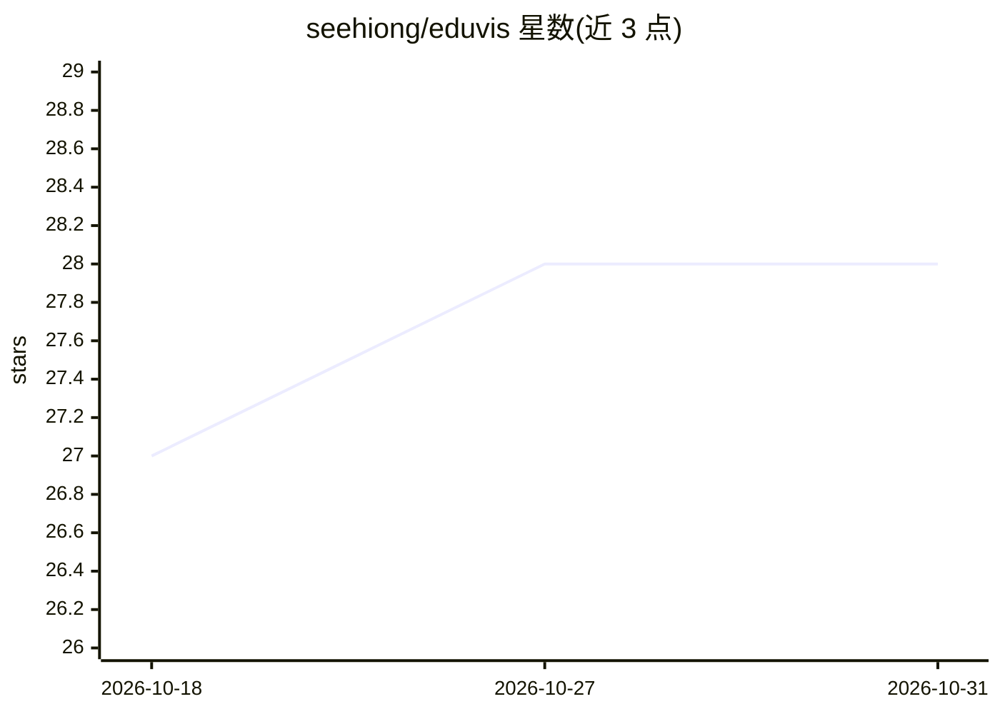

# seehiong/eduvis

⭐ 28 · Python · NOASSERTION · 推送 2026-10-11 · [GitHub](https://github.com/seehiong/eduvis) · [官网](https://seehiong.github.io/eduvis/showcase/) · 个人维护

**课程感知的教育内容规范：教学中间表示、编译校验与 SVG 渲染**

面向教育场景的开放规范与工具链：定义机器可读的教学中间表示（IR），将教学结构、课程知识与学习者状态解耦为正交层，配套编译管线、schema 校验器与参考 SVG 渲染器；另有基于 Pyodide/WASM 的浏览器端 EduVis Studio IDE（六视图同步投影）。提供 Python 包（pip install eduvis），v1.3 起附 Agentic 生成子系统：LangGraph + FastAPI + 本地 Ollama/Qwen3.5 生成题目草稿，由 EduVis Core 做确定性校验。适用教师、课程设计者与教育 agent 开发者。

## 筛选速览

| 维度 | 判定 | 备注 |
|---|---|---|
| AI 角色 | `ai-ecosystem` | LLM/agent 周边工具 |
| 许可风险 | `none` | NOASSERTION |
| 部署形态 | `library` | 以包/库形式分发 |
| 模型依赖 | local-ok | 支持本地模型 |
| 硬件要求 | — | 无带数字的原话,不猜 |
| 安装摩擦 | `low` | 无编译、无系统依赖或容器化 |
| 成熟度 | — | 结构信号不足 |

## 能力要点

- 课程感知的教学中间表示（IR）与编译/校验/渲染管线
- 浏览器端 Studio IDE（Pyodide/WASM），规范投影为六个同步视图
- Agent 管线：LLM 提案 + 确定性编译校验，支持本地 Ollama 模型
- 内置 SM-2 间隔重复、学习计划评分等教学引擎算法

## 适用场景

- 用自然语言生成经校验的课程对齐试卷与测验
- 构建输出结构化教学规范而非自由文本的教育 agent
- 设计可复用的概念依赖图与教学进阶规则

## 场景标签

`知识图谱` · 领域:知识与检索

## 证据(README 行号)

> L23: |**AI / Agent Developer**|Build educational agents that output deterministically validated IR instead of raw, uncon
> L90: |**Step 2**|Invokes the full LangGraph workflow — intent parsing → LLM question generation → EduVis Core blueprint 

## 星数曲线

2026-10-18 27 → 2026-10-31 28（+1）

---
*卡片 v1 · prompt 1.4 · 生成 2026-10-26 · 置信度 mid · 依据 README sha `f3f4b91ef86a` · [字段定义](../../DATASET.md)*
