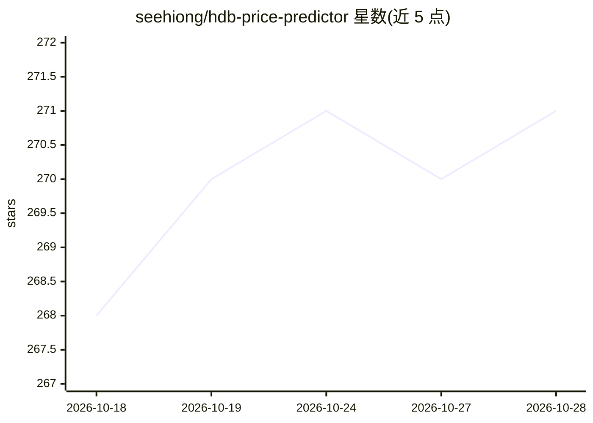

# seehiong/hdb-price-predictor

⭐ 271 · HTML · 推送 2026-09-12 · [GitHub](https://github.com/seehiong/hdb-price-predictor) · [官网](https://seehiong.github.io/hdb-price-predictor/) · 个人维护

**浏览器内新加坡房产估价引擎：双 XGBoost 模型毫秒级本地推理**

纯静态网页应用：将两个 XGBoost 模型（HDB 组屋 600 棵树 / 私宅非有地 77 棵树）导出为 JSON 树结构，用纯 JavaScript Float32Array 树遍历在浏览器内完成估价推理（<1ms），无服务器、无 API key、可离线。提供历史可比估价与指数调整的远期预测两种模式，集成 Leaflet 交易地图与 9,818 个邮政编码自动填充，另附 Python ETL 与再训练管线，采用按时间顺序的留出验证（MAPE 4.63% HDB / 6.27% 私宅）。面向购房与房产估值场景的终端用户及关注客户端 ML 的开发者。

## 筛选速览

| 维度 | 判定 | 备注 |
|---|---|---|
| AI 角色 | `ai-native` | 本体是模型或模型工具 |
| 许可风险 | `none` | — |
| 部署形态 | `library` | 以包/库形式分发 |
| 模型依赖 | — | README 未给出锁定关系 |
| 硬件要求 | — | 无带数字的原话,不猜 |
| 安装摩擦 | `low` | 无编译、无系统依赖或容器化 |
| 成熟度 | — | 结构信号不足 |

## 能力要点

- 浏览器内纯 JS 遍历 600 棵 XGBoost 决策树，推理 <1ms，零服务器依赖
- 双模型覆盖 HDB 组屋与私宅非有地产，按时间顺序留出验证
- 历史可比估价与官方价格指数调整的远期预测两种模式，误差带标注区分实测与假设
- Python ETL 管线从 Data.gov.sg 拉取数据并在数秒内完成再训练

## 适用场景

- 查询新加坡组屋或公寓在历史或未来年份的估计转售价
- 查看某街区或楼盘最近 50 笔真实转售交易的地图
- 用官方数据自行再训练并导出新的浏览器端模型

## 场景标签

`数据分析` · 领域:效率与自动化

## 证据(README 行号)

> L3: An in-browser AI engine and automated machine learning pipeline for estimating Singapore Housing & Development Board
> L5: Powered by client-side **XGBoost tree traversal (< 1ms latency)**, this application runs entirely inside the user's 
> L30:  - Direct in-browser evaluation of 600 XGBoost decision trees in pure JavaScript (~0.2ms).

## 星数曲线

2026-10-18 268 → 2026-10-28 271（+3）

---
*卡片 v1 · prompt 1.4 · 生成 2026-10-22 · 置信度 mid · 依据 README sha `0b6827cfc08a` · [字段定义](../../DATASET.md)*
