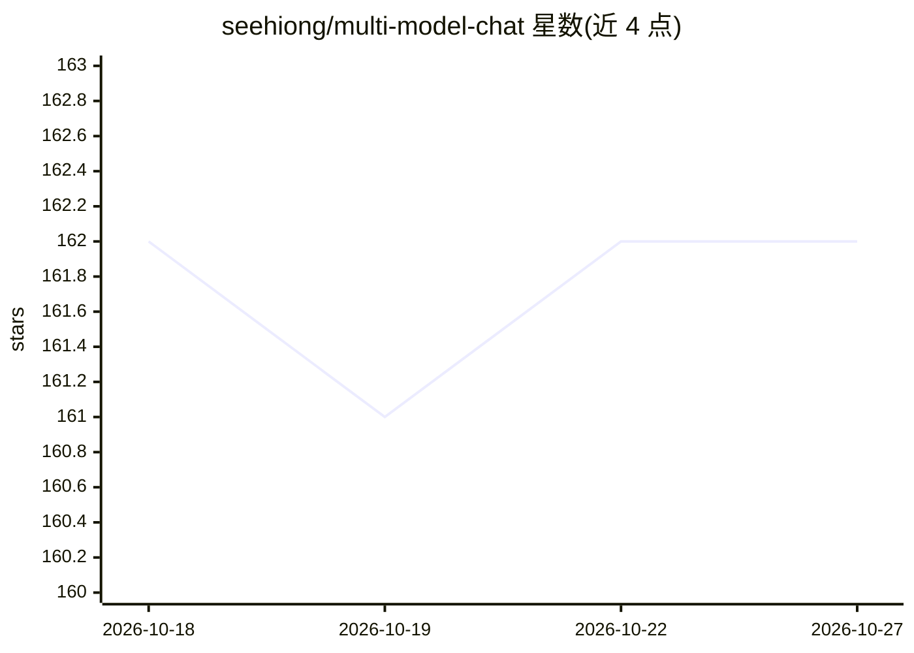

# seehiong/multi-model-chat

⭐ 162 · TypeScript · MIT · 推送 2026-06-28 · [GitHub](https://github.com/seehiong/multi-model-chat) · [官网](https://seehiong.github.io/multi-model-chat/) · 个人维护

**网页聊天应用：同时向多个大模型提问并实时对比回答**

基于 React 18 + TypeScript + Vite + Tailwind CSS 构建的纯客户端、无服务器端 Web 应用：可同时向最多 5 个模型提问，各模型回答实时逐个显示，支持任意 OpenAI 兼容端点（OpenRouter 开箱即配），并可连接 Ollama 等本地模型与云端 API 对比。回答以 Markdown 渲染，API 密钥与配置保存在浏览器 localStorage。提供两种构建方式：可打包为单文件 HTML 离线使用，或相对路径静态构建部署到任意静态主机。给需要在多模型间对比输出的用户使用；本地模型需自行配置 CORS（如 OLLAMA_ORIGINS）。

## 筛选速览

| 维度 | 判定 | 备注 |
|---|---|---|
| AI 角色 | `ai-native` | 本体是模型或模型工具 |
| 许可风险 | `permissive` | MIT |
| 部署形态 | `library` | 以包/库形式分发 |
| 模型依赖 | local-ok | 支持本地模型 |
| 硬件要求 | — | 无带数字的原话,不猜 |
| 安装摩擦 | `low` | 无编译、无系统依赖或容器化 |
| 成熟度 | — | 结构信号不足 |

## 能力要点

- 同时向最多 5 个模型提问，各回答独立实时显示
- 原生支持任意 OpenAI 兼容端点，OpenRouter 预配置
- 支持 Ollama 本地模型与云端 API 对比
- 可构建为单文件 HTML 离线使用，API 密钥仅存浏览器

## 适用场景

- 同一问题发给多个模型，对比回答质量后选型
- 本地模型与云端模型在浏览器内直接对比
- 无需服务器部署，单文件 HTML 离线使用或托管到静态站点

## 场景标签

`聊天机器人` `模型评测` · 领域:对话与助手

## 证据(README 行号)

> L3: A modern web application that allows you to chat with multiple large language models simultaneously and compare thei
> L13: - **Concurrent Model Queries**: Chat with up to 5 different AI models at the same time.
> L16: - **Remote API Integration**: Natively supports any OpenAI-compatible endpoint, with OpenRouter configured out of t

## 星数曲线

2026-10-18 162 → 2026-10-27 162（+0）

---
*卡片 v1 · prompt 1.4 · 生成 2026-10-22 · 置信度 high · 依据 README sha `52b90d0007cd` · [字段定义](../../DATASET.md)*
