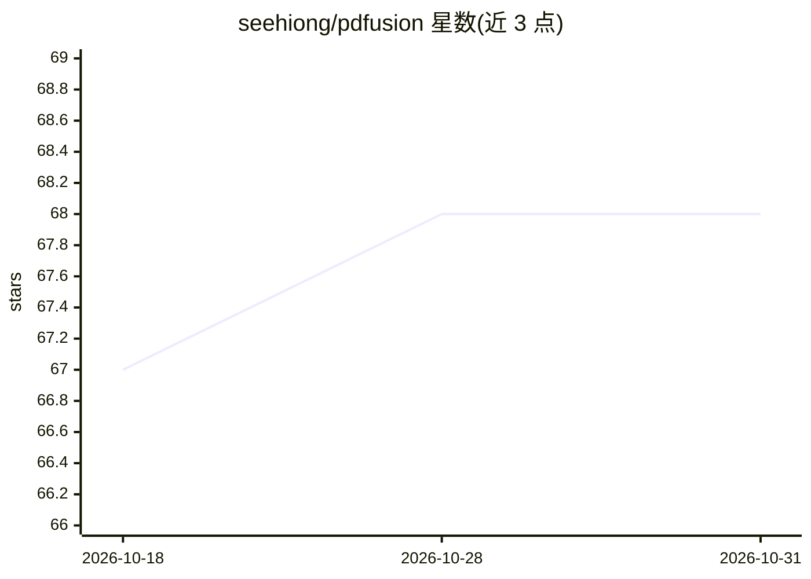

# seehiong/pdfusion

⭐ 68 · TypeScript · MIT · 推送 2026-07-25 · [GitHub](https://github.com/seehiong/pdfusion) · [官网](https://seehiong.github.io/pdfusion/) · 个人维护

**浏览器内 PDF 解析与 Markdown 转换工具（BYOK 视觉 OCR）**

纯前端 React SPA：使用 PDF.js 在浏览器沙箱内解析上传的 PDF，抽取文本与版面并输出结构化 Markdown，文件存储在 IndexedDB，除用户配置的 AI OCR 请求外不上传第三方服务器。提供两种分析模式：PDF.js 直接文本解析（免费即时）与渲染高分辨率页面后由视觉 LLM 重建表格/公式/标题。AI 采用 BYOK 模式，客户端直连 Ollama（本地）、OpenRouter、Google Gemini 或任意 OpenAI 兼容端点，各提供方凭据独立保存。源码经 npm 安装、Vite 构建，部署为 GitHub Pages 静态站点，另有在线 Demo。

## 筛选速览

| 维度 | 判定 | 备注 |
|---|---|---|
| AI 角色 | `ai-enhanced` | 去掉 AI 部分产品仍成立 |
| 许可风险 | `permissive` | MIT |
| 部署形态 | `library` | 以包/库形式分发 |
| 模型依赖 | local-ok | 支持本地模型 |
| 硬件要求 | — | 无带数字的原话,不猜 |
| 安装摩擦 | `low` | 无编译、无系统依赖或容器化 |
| 成熟度 | — | 结构信号不足 |

## 能力要点

- 全程浏览器内运行，文件存 IndexedDB，无需后端
- 双模式：PDF.js 快速文本抽取与视觉 LLM 版面重建
- BYOK 客户端直连 Ollama/OpenRouter/Gemini/OpenAI 兼容端点，隔离式配置档案
- 静态 SPA 可部署到 GitHub Pages，含在线 Demo

## 适用场景

- 在不安装服务端的前提下把 PDF 转成结构化 Markdown
- 使用本地 Ollama 视觉模型离线做 OCR 与表格重建
- 在意隐私、希望文件不离开浏览器的文档处理

## 场景标签

`OCR` `文档解析` · 领域:知识与检索

## 证据(README 行号)

> L3: PDFusion is a complete PDF analysis application that runs **entirely in your web browser**. It extracts text and pag
> L14: - **AI/LLM OCR**: Direct client-side integration with **Ollama (local)**, **OpenRouter (cloud)**, **Google Gemini (
> L109:  - **Vision Layout:** Render pages to high-resolution canvases and perform visual OCR using local/cloud LLMs to re

## 星数曲线

2026-10-18 67 → 2026-10-31 68（+1）

---
*卡片 v1 · prompt 1.4 · 生成 2026-10-24 · 置信度 high · 依据 README sha `98d761dd572c` · [字段定义](../../DATASET.md)*
