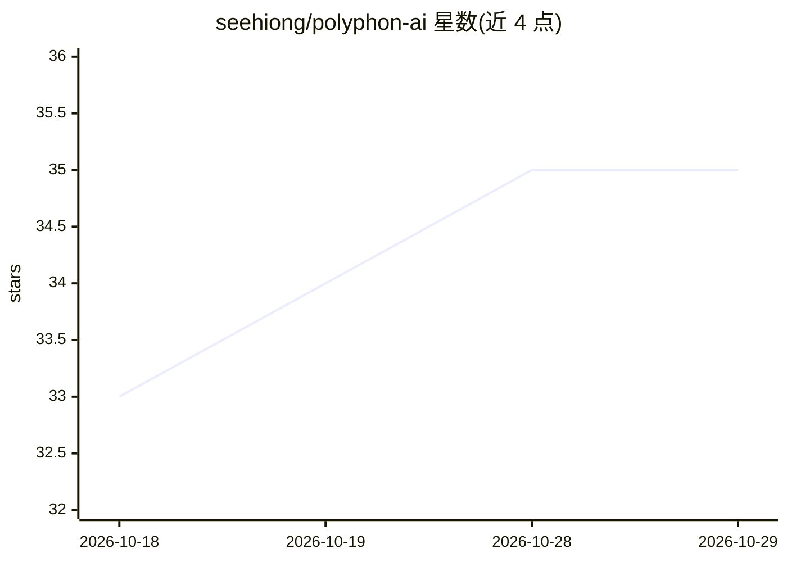

# seehiong/polyphon-ai

⭐ 35 · Python · Apache-2.0 · 推送 2026-09-12 · [GitHub](https://github.com/seehiong/polyphon-ai) · 个人维护 · 中文 README

**本地离线多人语音转写与说话人识别引擎，带持久化声纹身份**

面向需要隐私保护的会议/音频转写用户的本地引擎：用 faster-whisper 做 ASR、pyannote 做说话人分离，通过多尺度边界对齐按声学嵌入邻近度解决重叠/打断话语归属；VoiceDB 可注册说话人声纹，使 SPEAKER_00 在历史与未来录音中持久映射为真实姓名。支持中英混说与实时流式转写，可将转写结果接入本地 LLM（Ollama/llama.cpp/vLLM 等 OpenAI 兼容端点）生成摘要与行动项。限制：需 FFmpeg（Windows 需 shared 构建）与 Hugging Face 受限模型 token；提供 pip 安装、CLI 与 Polyphon Studio 网页界面。

## 筛选速览

| 维度 | 判定 | 备注 |
|---|---|---|
| AI 角色 | `ai-native` | 本体是模型或模型工具 |
| 许可风险 | `permissive` | Apache-2.0 |
| 部署形态 | `desktop` | 安装包/桌面程序 |
| 模型依赖 | local-ok | 支持本地模型 |
| 硬件要求 | — | 无带数字的原话,不猜 |
| 安装摩擦 | `low` | 无编译、无系统依赖或容器化 |
| 成熟度 | — | 结构信号不足 |

## 能力要点

- 多尺度时间戳对齐处理重叠与打断发言
- VoiceDB 持久声纹身份，跨录音将 SPEAKER_00 映射为真实姓名
- 浏览器内同时采集本地麦克风与远端会议音频，无需会议机器人
- 结构化提取接入本地 OpenAI 兼容 LLM 生成摘要与决策

## 适用场景

- 离线转写多人会议并标注发言人姓名
- 在保密场景（医疗/法务）本地处理录音不出网
- 边开会边实时流式转写并会后生成结构化纪要

## 场景标签

`语音识别` · 领域:感知与多模态

## 证据(README 行号)

> L5: **Local, Identity-Aware Transcription & Diarization Engine**
> L38: - **👤 VoiceDB (Persistent Identity):** Enroll local speaker voiceprints. `SPEAKER_00` and `SPEAKER_01` automaticall
> L43: - **🧠 Local Structured Extraction:** Seamlessly pipelines reconciled speaker transcripts into local LLMs (via `llam

## 星数曲线

2026-10-18 33 → 2026-10-29 35（+2）

---
*卡片 v1 · prompt 1.4 · 生成 2026-10-25 · 置信度 mid · 依据 README sha `7c2e6039f2c0` · [字段定义](../../DATASET.md)*
