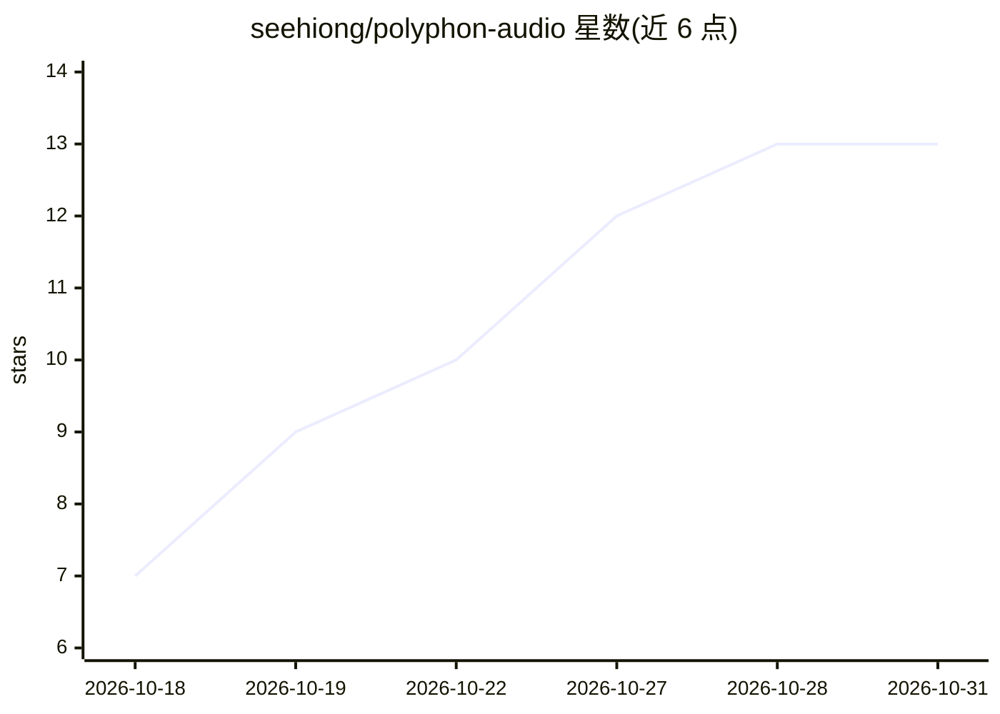

# seehiong/polyphon-audio

⭐ 13 · Python · Apache-2.0 · 推送 2026-10-03 · [GitHub](https://github.com/seehiong/polyphon-audio) · 个人维护

**本地离线 TTS 与语音克隆工具：多声音朗读、声音设计、音效生成与实时语音对话**

基于 audio.cpp（ggml 推理引擎）的本地文本转语音与语音克隆项目，模型下载后完全离线运行，不调用云端。功能包括短样本语音克隆、多声音旁白与对话拼接（支持内联 [pause] 标记）、纯文本描述生成新声音、音效与音乐片段生成，以及接入本地 OpenAI 兼容 LLM（默认 llama.cpp 的 llama-server + Qwen3-30B）的实时语音对话循环。提供 Gradio Web UI（studio.py）与纯脚本两种使用方式，后者仅需标准 Python 3。需先编译 audio.cpp，支持 AMD ROCm、NVIDIA CUDA、Vulkan 与 CPU 后端，五个模型合计约 7.5GB 显存（不含 LLM）。

## 筛选速览

| 维度 | 判定 | 备注 |
|---|---|---|
| AI 角色 | `ai-native` | 本体是模型或模型工具 |
| 许可风险 | `permissive` | Apache-2.0 |
| 部署形态 | `desktop` | 安装包/桌面程序 |
| 模型依赖 | local-ok | 支持本地模型 |
| 硬件要求 | `cpu-ok` | |
| 安装摩擦 | `high` | 编译与系统依赖俱全 |
| 成熟度 | — | 结构信号不足 |

## 能力要点

- 短参考样本克隆语音并生成任意文本
- 文本描述直接生成全新声音与音效/音乐片段
- 实时对话循环：ASR（Nemotron）→ 本地 LLM → Chatterbox TTS，模型常驻服务按需加载/卸载
- 纯脚本模式仅需标准 Python 3 解释器，无第三方 Python 包

## 适用场景

- 有声书、视频旁白与多角色对话配音的本地离线生成
- 不想上云的个人/团队做私有语音克隆与品牌声音设计
- 搭配本地 LLM 搭建可对话的语音助手

## 场景标签

`语音合成` `语音 Agent` · 领域:对话与助手

## 证据(README 行号)

> L3: **Local text-to-speech and voice cloning**
> L16: - **Voice cloning** — clone a voice from a short reference clip, then
> L25: - **A conversational voice-persona loop** — wire in a local LLM so the
> L31: Built on `audio.cpp` (a native

## 星数曲线

2026-10-18 7 → 2026-10-31 13（+6）

---
*卡片 v1 · prompt 1.4 · 生成 2026-10-31 · 置信度 mid · 依据 README sha `1add1b3500d2` · [字段定义](../../DATASET.md)*
