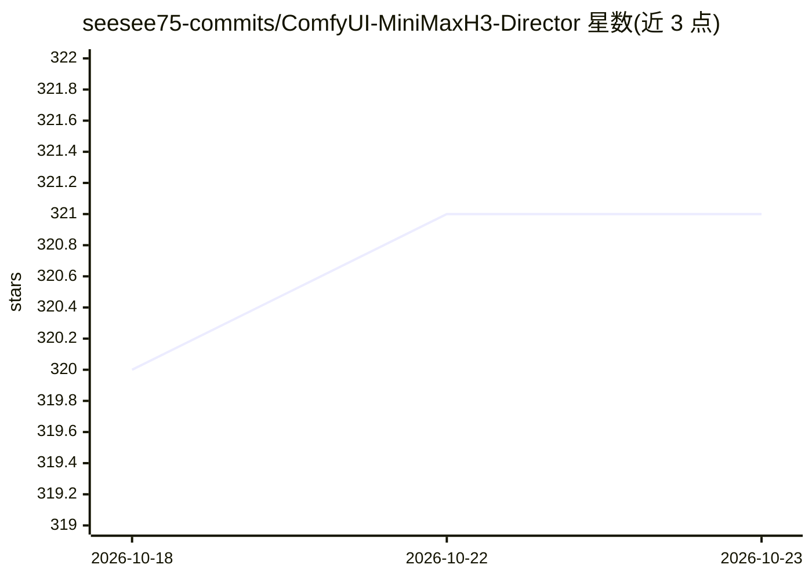

# seesee75-commits/ComfyUI-MiniMaxH3-Director

⭐ 321 · JavaScript · GPL-3.0 · 推送 2026-10-11 · [GitHub](https://github.com/seesee75-commits/ComfyUI-MiniMaxH3-Director) · 个人维护

**ComfyUI 内的 MiniMax H3 视频时间线编辑器节点集**

由 LTX Director 移植到 MiniMax H3 后端的 ComfyUI 自定义节点：把图像/视频/音频拖到轨道上按秒或帧修剪，每个片段写一条 prompt，形成分镜板而非单条提示词；节点实时编译模型将收到的确切 prompt 供运行前查看。共 5 个节点，含全镜头去噪预览、重拍片段拼接回原视频、本地视觉模型从参考图生成 prompt、保存批次末帧等。要求 ComfyUI ≥ 0.30.0、Python 3.10+，无额外 pip 依赖；fp8 权重约 21 GB，16 GB VRAM 可在 480p–768p 下配合 ComfyUI 卸载运行。

## 筛选速览

| 维度 | 判定 | 备注 |
|---|---|---|
| AI 角色 | `ai-ecosystem` | LLM/agent 周边工具 |
| 许可风险 | `viral` | GPL-3.0 |
| 部署形态 | `library` | 以包/库形式分发 |
| 模型依赖 | local-ok | 支持本地模型 |
| 硬件要求 | `gpu-8g` | |
| 安装摩擦 | `medium` | 含编译或系统依赖之一 |
| 成熟度 | — | 结构信号不足 |

## 能力要点

- 时间线分镜编辑，逐 shot 编写 prompt 并实时编译显示
- 支持参考图像/视频/音频、首末帧锚定与联合音频生成
- Retake Stitch 将重生成片段拼回基础视频
- Analyze 按钮可接 Ollama / LM Studio / OpenAI 兼容端点的本地 VLM

## 适用场景

- 在 ComfyUI 里为 MiniMax H3 搭分镜板并生成带音频的视频
- 对不满意的片段做重拍并拼接回成片
- 用本地视觉模型从参考图自动写出提示词

## 场景标签

`视频生成` · 领域:内容生成

## 证据(README 行号)

> L3: **A timeline editor for MiniMax H3 inside ComfyUI.**
> L21: > This is the LTX Director
> L128: Five nodes, category **MiniMax H3**:

## 星数曲线

2026-10-18 320 → 2026-10-23 321（+1）

---
*卡片 v1 · prompt 1.4 · 生成 2026-10-21 · 置信度 mid · 依据 README sha `cc0926520ad5` · [字段定义](../../DATASET.md)*
