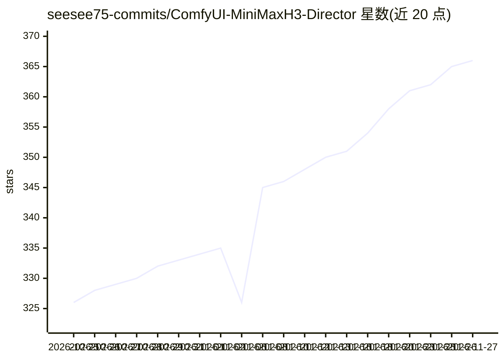

# seesee75-commits/ComfyUI-MiniMaxH3-Director

⭐ 366 · Python · GPL-3.0 · 推送 2026-11-03 · [GitHub](https://github.com/seesee75-commits/ComfyUI-MiniMaxH3-Director) · 个人维护

**ComfyUI 时间线编辑节点：用 MiniMax H3 分镜生成任意长度带声视频**

面向 ComfyUI 用户的自定义节点包，提供时间线分镜编辑器：把角色、语音、歌曲与图片放在卡片上，按镜头写入时间线后一次性生成，规划器将视频切为约十秒的渲染段逐段渲染并拼接，画面与声音跨接缝延续。支持首尾帧、References、ControlNet 姿态/边缘/深度控制、分镜面板（Qwen Image 绘制）、Whisper 歌词对齐，以及可选的本地模型（Ollama、LM Studio）或 API 辅助撰写镜头与提示词。需 ComfyUI ≥0.37.0、GPU 与约 60 GB 模型磁盘空间。

## 筛选速览

| 维度 | 判定 | 备注 |
|---|---|---|
| AI 角色 | `ai-native` | 本体是模型或模型工具 |
| 许可风险 | `viral` | GPL-3.0 |
| 部署形态 | `library` | 以包/库形式分发 |
| 模型依赖 | local-ok | 支持本地模型 |
| 硬件要求 | — | 无带数字的原话,不猜 |
| 安装摩擦 | `low` | 无编译、无系统依赖或容器化 |
| 成熟度 | — | 结构信号不足 |

## 能力要点

- 任意长度视频：按 H3 帧网格切段渲染，画面与声音跨接缝延续
- 时间线分镜：每镜头独立文本、相机、卡片与台词，音频轨跨镜头
- References/首尾帧模式让角色与画面起止对齐到用户素材
- 官方 H3 ControlNet 支持姿态、边缘、深度与 inpaint 控制

## 适用场景

- 在 ComfyUI 里生成分镜驱动的多镜头短片
- 让角色按参考图片保持一致并配音唱歌
- 用姿态/深度控制视频驱动自己的角色
- 为一个锁定歌曲生成歌词对齐的音乐视频

## 场景标签

`视频生成` · 领域:内容生成

## 证据(README 行号)

> L1: # MiniMax H3 Director for ComfyUI
> L39: - **Any length.** The planner splits the video into H3 render parts on H3's frame grid; each part continues the pre
> L48: - **Optional AI.** A local model (Ollama, LM Studio) or an API writes shots, prompts and card descriptions on reque

## 星数曲线

2026-10-25 326 → 2026-11-27 366（+40）

---
*卡片 v1 · prompt 1.4 · 生成 2026-11-25 · 置信度 mid · 依据 README sha `f21c45da0ade` · [字段定义](../../DATASET.md)*
