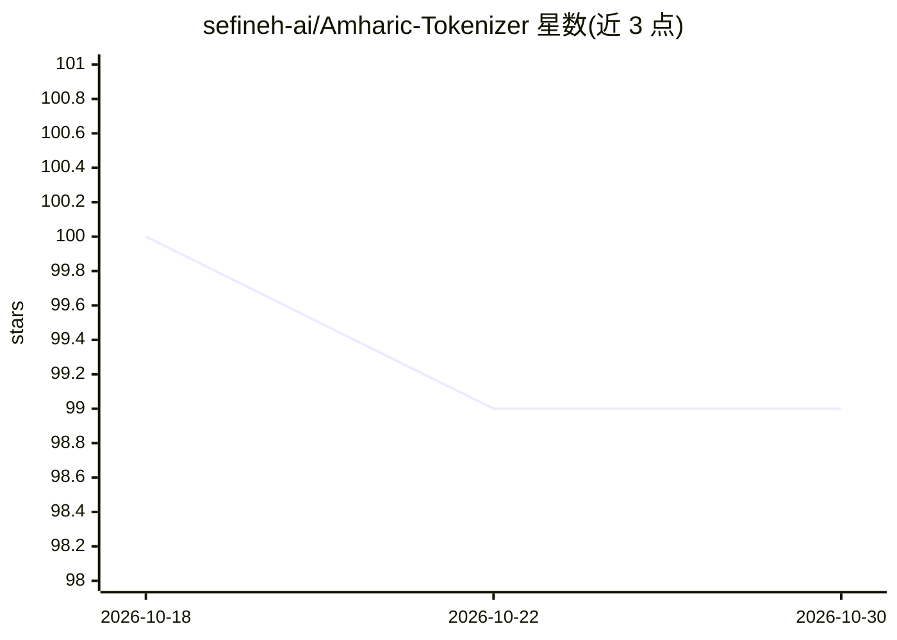

# sefineh-ai/Amharic-Tokenizer

⭐ 99 · Python · MIT · 推送 2026-09-24 · [GitHub](https://github.com/sefineh-ai/Amharic-Tokenizer) · [官网](https://pypi.org/project/amharic-tokenizer) · 个人维护

**阿姆哈拉语音节感知 BPE 分词器库，含训练与 CLI**

面向阿姆哈拉语（አማርኛ）的 GPT 风格 BPE 类分词器 Python 库：流水线为清洗→fidel 分解→BPE 训练/应用→反分词，核心用 Cython 编写。v0.2.7 重写训练与分词算法，1600 万词训练从 12 小时降至 42 秒，分词变为线性复杂度并按词缓存。捆绑两个预训练模型（3 万词表），提供 amh-tokenizer CLI（train/clean/tokenize/encode/decode/models）与类型化 Python API；词表外字符（拉丁字母、数字、多数标点）编码为 <unk> 且解码时丢弃。

## 筛选速览

| 维度 | 判定 | 备注 |
|---|---|---|
| AI 角色 | `ai-ecosystem` | LLM/agent 周边工具 |
| 许可风险 | `permissive` | MIT |
| 部署形态 | `library` | 以包/库形式分发 |
| 模型依赖 | — | README 未给出锁定关系 |
| 硬件要求 | — | 无带数字的原话,不猜 |
| 安装摩擦 | `medium` | 含编译或系统依赖之一 |
| 成熟度 | — | 结构信号不足 |

## 能力要点

- 音节感知：在分解后的 fidel 字符上做 BPE，反分词时重组原字符
- Cython 核心，1600 万词训练 12 小时→42 秒，分词线性复杂度并按词缓存（最多 20 万词）
- 捆绑 v0.2.6/v0.2.7 两个预训练模型，load 支持名称或文件路径
- 提供 CLI 与 train/tokenize/encode/decode/save/load 类型化 API

## 适用场景

- 为阿姆哈拉语 LLM 训练准备分词器
- 在自己的语料上训练 BPE 词表并复用
- 命令行批量清洗、分词与编解码阿姆哈拉语文本

## 场景标签

 · 领域:NLP/低资源语言工具

## 证据(README 行号)

> L14: **Amharic tokenizer with a GPT-style BPE-like pipeline over decomposed fidel.**
> L85: pip install amharic-tokenizer

## 星数曲线

2026-10-18 100 → 2026-10-30 99（-1）

---
*卡片 v1 · prompt 1.4 · 生成 2026-10-23 · 置信度 high · 依据 README sha `43cda6fe5468` · [字段定义](../../DATASET.md)*
