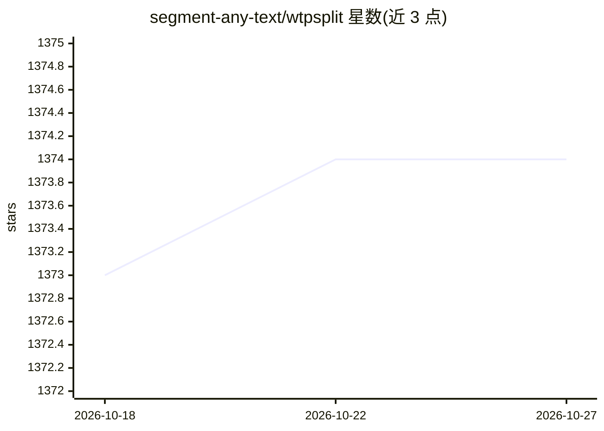

# segment-any-text/wtpsplit

⭐ 1,374 · Python · MIT · 推送 2026-09-25 · [GitHub](https://github.com/segment-any-text/wtpsplit) · 组织维护

**多语言句子与段落切分工具库（SaT/WtP 模型，85 语言）**

Python 库 wtpsplit，实现 SaT（Segment any Text）与 WtP 两种预训练模型，将文本切分为句子、段落或其他语义单元，覆盖 85 种语言。提供 pip 安装、ONNX 推理（CUDA/CPU）、torch.compile 与 NVIDIA AITune 加速选项；v2.2+ 支持基于 Viterbi 的长度约束切分，可用 LoRA 做领域/风格适配（提供 81 种语言的预训练 LoRA 模块），也可加载到 HuggingFace transformers。面向需要句子边界检测的开发者与科研用户。

## 筛选速览

| 维度 | 判定 | 备注 |
|---|---|---|
| AI 角色 | `ai-native` | 本体是模型或模型工具 |
| 许可风险 | `permissive` | MIT |
| 部署形态 | `library` | 以包/库形式分发 |
| 模型依赖 | — | README 未给出锁定关系 |
| 硬件要求 | — | 无带数字的原话,不猜 |
| 安装摩擦 | `medium` | 含编译或系统依赖之一 |
| 成熟度 | — | 结构信号不足 |

## 能力要点

- SaT/WtP 预训练模型覆盖 85 种语言的句子切分
- 支持 ONNX、torch.compile、NVIDIA AITune 多种推理加速路径
- v2.2+ 长度约束切分（Viterbi + gaussian/lognormal 等 prior）
- LoRA 领域/风格适配，提供 81 种语言预训练 LoRA 模块

## 适用场景

- 对无标点或多语言文本做句子边界检测
- 为嵌入模型或存储切块时控制段落长度
- 对法律文本、推文、ASR 转写等特定风格做切分适配

## 场景标签

 · 领域:NLP/文本处理

## 证据(README 行号)

> L4: This repository allows you to segment text into sentences or other semantic units. It implements the models from:
> L6: - **SaT** &mdash; Segment Any Text: A Universal Approach for Robust, Efficient and Adaptable Sentence Segmentation b
> L9: The namesake WtP is maintained for consistency. Our new followup SaT provides robust, efficient and adaptable senten

## 星数曲线

2026-10-18 1,373 → 2026-10-27 1,374（+1）

---
*卡片 v1 · prompt 1.4 · 生成 2026-10-21 · 置信度 high · 依据 README sha `5c04097c5f98` · [字段定义](../../DATASET.md)*
