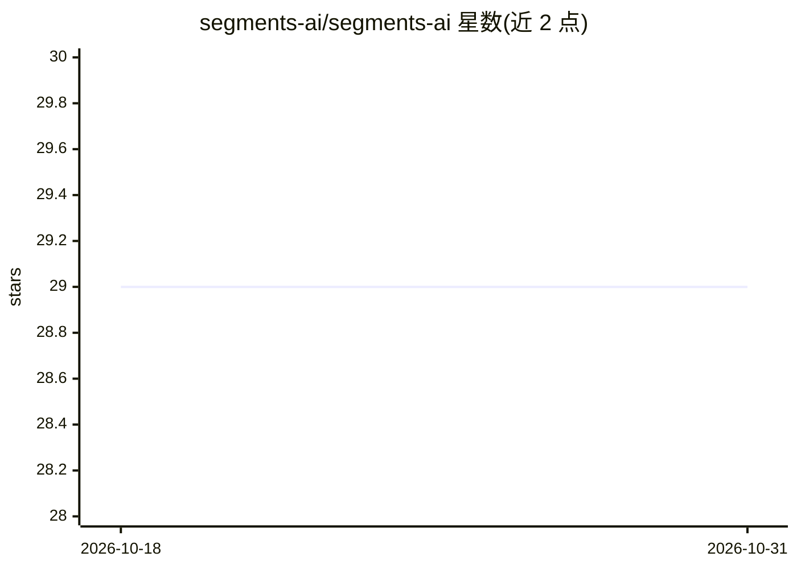

# segments-ai/segments-ai

⭐ 29 · Python · MIT · 推送 2026-10-23 · [GitHub](https://github.com/segments-ai/segments-ai) · [官网](http://segments.ai) · 组织维护

**计算机视觉训练数据平台 Segments.ai 的 Python SDK**

面向计算机视觉工程师与标注团队的训练数据平台 Segments.ai 的官方 Python SDK：通过 API 读取和管理数据集、标注任务（图像标注、点云检测与分割、全景分割等），衔接数据标注、模型训练与失败案例分析的迭代流程。需配合 Segments.ai 平台账号使用，安装方式与用法见官方文档，README 本身仅提供快速入门与文档入口链接。

## 筛选速览

| 维度 | 判定 | 备注 |
|---|---|---|
| AI 角色 | `ai-ecosystem` | LLM/agent 周边工具 |
| 许可风险 | `permissive` | MIT |
| 部署形态 | `None` |  |
| 模型依赖 | — | README 未给出锁定关系 |
| 硬件要求 | — | 无带数字的原话,不猜 |
| 安装摩擦 | `low` | 无编译、无系统依赖或容器化 |
| 成熟度 | — | 结构信号不足 |

## 能力要点

- 通过 Python API 访问 Segments.ai 训练数据平台
- 覆盖图像标注、点云检测/分割、全景分割等标注类型
- 提供 readthedocs 在线文档与快速入门

## 适用场景

- 用脚本批量管理 Segments.ai 上的数据集与标注任务
- 在模型训练流水线中程序化读取标注数据
- 自动化标注团队的数据迭代流程

## 场景标签

 · 领域:计算机视觉/数据标注

## 证据(README 行号)

> L15: Segments.ai is the training data platform for computer vision engineers and labeling teams. Our powerful labeling i

## 星数曲线

2026-10-18 29 → 2026-10-31 29（+0）

---
*卡片 v1 · prompt 1.4 · 生成 2026-10-26 · 置信度 low · 依据 README sha `e362992482e0` · [字段定义](../../DATASET.md)*
