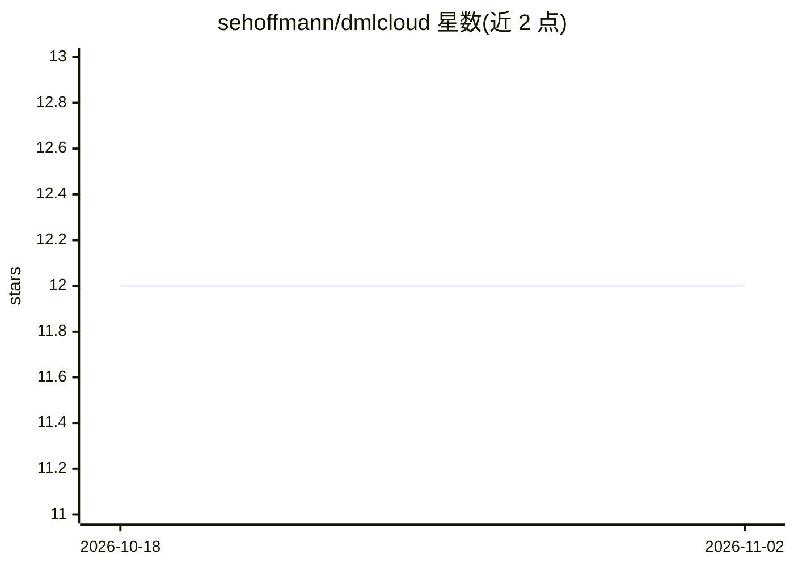

# sehoffmann/dmlcloud

⭐ 12 · Python · BSD-3-Clause · 推送 2026-04-28 · [GitHub](https://github.com/sehoffmann/dmlcloud) · 个人维护

**面向 HPC 集群的 PyTorch 分布式训练库**

基于 torch 的分布式深度学习库，用于在 HPC 集群上运行分布式训练，支持 Slurm 与 MPI 环境初始化 torch.distributed。设计原则是不引入多余抽象，代码接近常规 PyTorch 训练循环；dml.Pipeline 构造函数仅 2 个参数。提供分布式指标、日志诊断、Wandb 与 Tensorboard 支持，附带 dmlrun 命令（torchrun 的封装）便于单机多卡原型调试。通过 PyPI 或 GitHub 源码安装。

## 筛选速览

| 维度 | 判定 | 备注 |
|---|---|---|
| AI 角色 | `ai-ecosystem` | LLM/agent 周边工具 |
| 许可风险 | `permissive` | BSD-3-Clause |
| 部署形态 | `library` | 以包/库形式分发 |
| 模型依赖 | — | README 未给出锁定关系 |
| 硬件要求 | — | 无带数字的原话,不猜 |
| 安装摩擦 | `low` | 无编译、无系统依赖或容器化 |
| 成熟度 | — | 结构信号不足 |

## 能力要点

- 自动读取 Slurm/MPI 环境变量初始化 torch.distributed
- 分布式指标与详尽日志诊断
- Wandb 与 Tensorboard 支持
- dmlrun 封装 torchrun 便于单机多 GPU 原型

## 适用场景

- 在 Slurm 集群上跨多节点训练 PyTorch 模型
- 以接近原生训练循环的方式改造现有代码做分布式训练
- 多 GPU 实验中用 dmlrun 快速启动并记录指标

## 场景标签

`模型训练` · 领域:训练与推理

## 证据(README 行号)

> L6: A torch library for easy distributed deep learning on HPC clusters. Supports both slurm and MPI. No unnecessary abst
> L39: ## Slurm Support

## 星数曲线

2026-10-18 12 → 2026-11-02 12（+0）

---
*卡片 v1 · prompt 1.4 · 生成 2026-11-01 · 置信度 high · 依据 README sha `60ecc8fdc483` · [字段定义](../../DATASET.md)*
