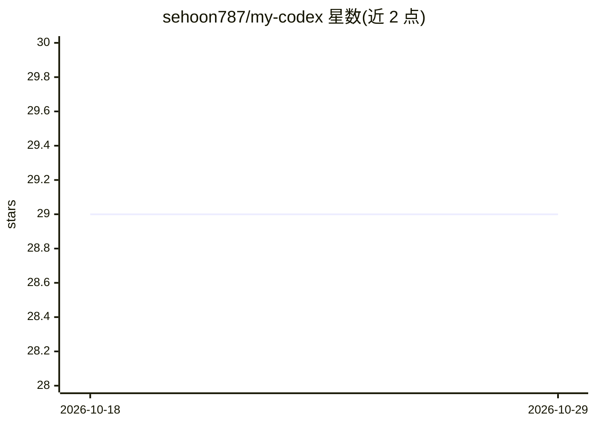

# sehoon787/my-codex

⭐ 29 · JavaScript · MIT · 推送 2026-10-28 · [GitHub](https://github.com/sehoon787/my-codex) · [官网](https://sehoon787.github.io/my-codex/) · 个人维护

**面向 Codex CLI 的一体化 agent 装配套件：17 个 agent 与技能即装即用**

为 OpenAI Codex CLI 提供的一键安装 agent harness：通过 install.sh 安装 17 个核心 agent、110+ 技能条目与 3 个 MCP 服务器（Serena 语言符号服务、Headroom 上下文压缩、codeburn 成本统计）。核心机制是 Boss 元编排层——不写代码，而是在会话启动时构建能力注册表，对请求分类并按优先链（技能→专家 agent→多 agent→通用兜底）经 spawn_agent 委派，完成后独立读文件、跑测试验证。另提供 my-claude 姊妹项目适配 Claude Code。

## 筛选速览

| 维度 | 判定 | 备注 |
|---|---|---|
| AI 角色 | `ai-ecosystem` | LLM/agent 周边工具 |
| 许可风险 | `permissive` | MIT |
| 部署形态 | `library` | 以包/库形式分发 |
| 模型依赖 | — | README 未给出锁定关系 |
| 硬件要求 | — | 无带数字的原话,不猜 |
| 安装摩擦 | `low` | 无编译、无系统依赖或容器化 |
| 成熟度 | — | 结构信号不足 |

## 能力要点

- Boss 元编排：运行时发现全部 agent/技能/MCP 工具并路由任务，无需配置文件
- 一键安装 17 个核心 agent 与可选 data-ai/llmops 扩展包（各含 13/4 个 agent）
- 技能档案机制：默认 core 档案仅暴露 30 项技能，规避 Codex 技能预算截断
- 整合 16 个开源项目（含 ast-grep、context7、exa 等工具链），来源与到达方式逐项记录

## 适用场景

- 为 Codex CLI 一次性配置好专家 agent 与技能库
- 让 Boss 编排器把编码任务自动委派给合适的专家 agent
- 在 Codex 与 Claude Code 两种 harness 间保持一致的技能暴露面

## 场景标签

`多智能体` `编码 Agent` · 领域:Agent 开发

## 证据(README 行号)

> L13: **All-in-one agent harness for Codex CLI.**
> L16: Boss discovers every agent, skill, and MCP tool at runtime,
> L92: Boss is the meta-orchestrator at the core of my-codex. It never writes code — it discovers, classifies, matches, de

## 星数曲线

2026-10-18 29 → 2026-10-29 29（+0）

---
*卡片 v1 · prompt 1.4 · 生成 2026-10-26 · 置信度 mid · 依据 README sha `0c174ff7fa50` · [字段定义](../../DATASET.md)*
