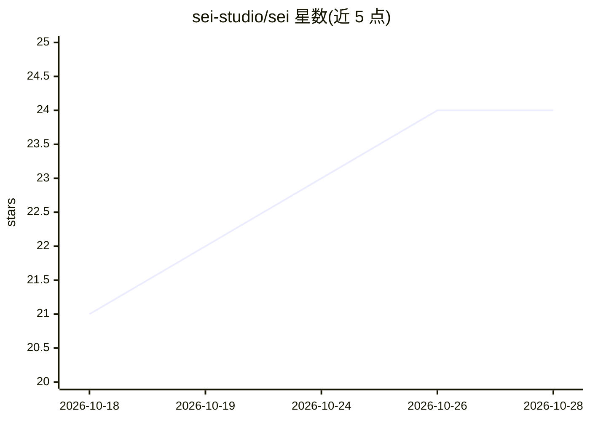

# sei-studio/sei

⭐ 24 · TypeScript · AGPL-3.0 · 推送 2026-10-28 · [GitHub](https://github.com/sei-studio/sei) · [官网](https://sei.gg) · 组织维护 · 中文 README

**面向玩家的 AI 游戏陪伴应用：聊天、语音通话并一起玩**

面向终端用户的 Electron 桌面应用（macOS/Windows），提供 AI 陪伴角色：可在 Minecraft、星露谷物语、饥荒联机版中以第二玩家身份加入游戏，应用内含 3D 国际象棋与画图游戏，Backseat 模式可观看任意游戏画面并语音讨论。支持多语言语音通话、跨会话长期记忆、Live2D 头像悬浮窗与网页搜索。模型接入提供三种方式：官方云计划、自带 API key（Anthropic/OpenAI/DeepSeek/Qwen 等）或本地 Ollama；语音识别在设备端运行。AGPL-3.0 许可。

## 筛选速览

| 维度 | 判定 | 备注 |
|---|---|---|
| AI 角色 | `ai-native` | 本体是模型或模型工具 |
| 许可风险 | `viral` | AGPL-3.0 |
| 部署形态 | `library` | 以包/库形式分发 |
| 模型依赖 | local-ok | 支持本地模型 |
| 硬件要求 | — | 无带数字的原话,不猜 |
| 安装摩擦 | `low` | 无编译、无系统依赖或容器化 |
| 成熟度 | `idea` | |

## 能力要点

- 陪伴角色在 Minecraft/星露谷/饥荒中以独立玩家身份加入游戏
- Backseat 模式共享屏幕观看并讨论任意游戏
- Maia-3 模型驱动的拟人国际象棋对弈
- 长期记忆、知识导入与设备端语音识别（Whisper/SenseVoice）

## 适用场景

- 玩游戏时让 AI 伙伴加入世界一同采集建造
- 语音通话并让陪伴角色记住跨游戏的经历
- 让 AI 陪伴看我玩其他游戏并一起讨论

## 场景标签

`语音 Agent` `聊天机器人` · 领域:对话与助手

## 证据(README 行号)

> L3: AI gaming companions. Call, livestream, and game with unique characters.
> L13: Sei (sei.gg) is an AI gaming companion app for macOS and Windows. You pick a companion, then chat, call, and play g

## 星数曲线

2026-10-18 21 → 2026-10-28 24（+3）

---
*卡片 v1 · prompt 1.4 · 生成 2026-10-27 · 置信度 high · 依据 README sha `55fdc5c0157a` · [字段定义](../../DATASET.md)*
