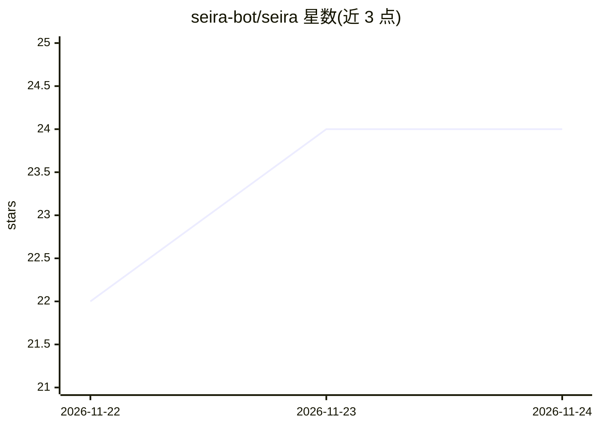

# seira-bot/seira

⭐ 31 · TypeScript · Apache-2.0 · 推送 2026-11-24 · [GitHub](https://github.com/seira-bot/seira) · [官网](https://seira.bot) · 组织维护

**把 Claude Code、Codex 等 25+ AI 引擎组队放进一个聊天桌面应用**

开源桌面应用（Electron），在单一聊天界面中以机器人群形式运行用户本机已装的 agent 程序（Claude Code、Codex、Gemini、Cursor、Copilot 等 30+ 引擎），复用用户已有的账号与订阅。本地 harness 服务器统一持有 agent 进程，将各引擎协议转换为 SSE 事件流并记录 NDJSON；shell 命令、文件编辑等风险操作以审批卡片交由用户放行。提供 Windows/Linux 安装包、npm 服务器版、Android 配对应用，支持云端桌面/本地 VM/本机三种执行环境，项目处于早期开发阶段。

## 筛选速览

| 维度 | 判定 | 备注 |
|---|---|---|
| AI 角色 | `ai-ecosystem` | LLM/agent 周边工具 |
| 许可风险 | `permissive` | Apache-2.0 |
| 部署形态 | `desktop` | 安装包/桌面程序 |
| 模型依赖 | locked-api |  |
| 硬件要求 | — | 无带数字的原话,不猜 |
| 安装摩擦 | `low` | 无编译、无系统依赖或容器化 |
| 成熟度 | `idea` | |

## 能力要点

- 以驱动器方式接入 30+ 引擎（含 ACP 协议程序与 OpenAI 兼容端点），未知驱动不影响其他 bot
- 权限代理将风险动作转为 Allow/Deny 审批卡片
- 每 bot 可选引擎与模型，支持对话中途切换；触发器、频道、团队 Markdown 一键安装
- 提供 MCP server 供 Claude Desktop/Cursor 反向控制，及 headless CLI 用于脚本与 CI

## 适用场景

- 在一个聊天界面统一管理本机多个 AI 编码 agent
- 给 bot 定时任务（如每天早上总结收件箱）并远程审批操作
- 自托管在 VPS/家庭服务器，从浏览器或手机访问自己的 agent 团队
- 通过 Composio 让 bot 操作 Gmail/Slack/GitHub 等外部应用

## 场景标签

`编码 Agent` `多智能体` `AI 助手` `GUI 自动化` · 领域:Agent 开发

## 证据(README 行号)

> L7:  Seira is a free, open source desktop app for Windows and Linux. It runs Claude Code, Codex, Gemini, and more than 2
> L50:  One small harness server on <code>127.0.0.1</code> owns every agent process. Transcripts and keys stay on your com
> L107: The harness server owns every agent process.

## 星数曲线

2026-11-22 22 → 2026-11-24 24（+2）

---
*卡片 v1 · prompt 1.4 · 生成 2026-11-22 · 置信度 high · 依据 README sha `b7980f411cf6` · [字段定义](../../DATASET.md)*
