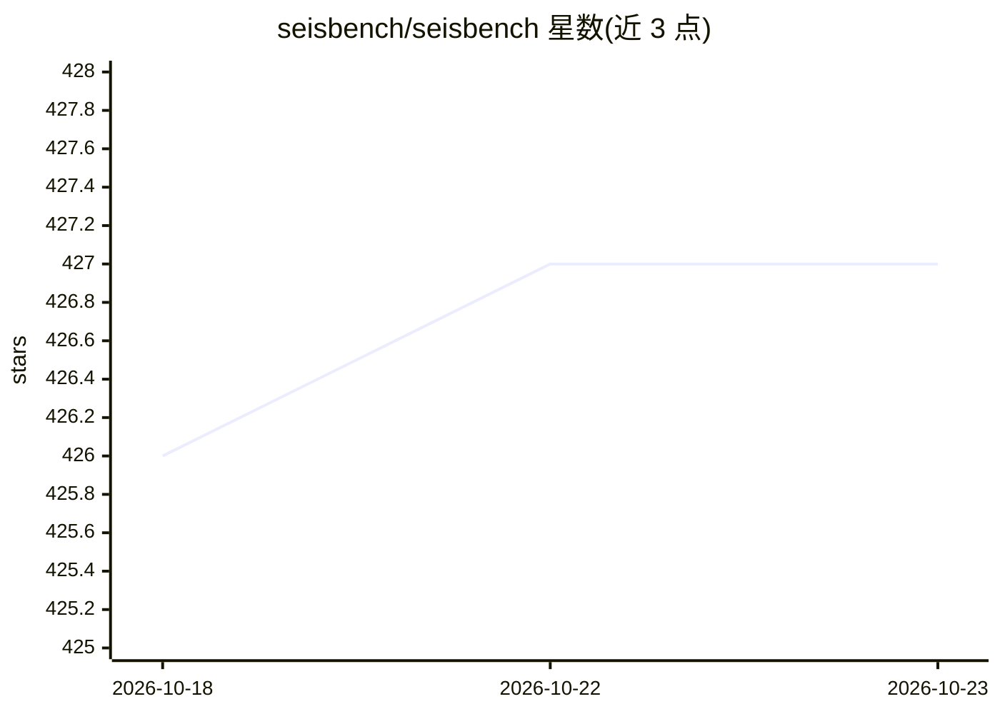

# seisbench/seisbench

⭐ 427 · Jupyter Notebook · GPL-3.0 · 推送 2026-10-05 · [GitHub](https://github.com/seisbench/seisbench) · 组织维护

**地震学机器学习工具箱：统一 API 加载数据集、训练与应用模型**

开源 Python 工具箱，为地震学任务提供机器学习的统一接口。含三个核心模块：data 提供基准地震数据集的访问与加载，models 收录地震学模型并支持创建、加载预训练权重或在任意数据集上训练，generate 提供数据生成流水线工具。覆盖震相拾取、去噪、深度估计、事件目录构建（GaMMA/PyOcto）及 DAS（分布式声波传感）数据的训练与应用。面向地震学科研与开发者，通过 pip 安装，基于 PyTorch，支持 CPU 或 CUDA GPU 运行，并提供 Colab 示例笔记本。

## 筛选速览

| 维度 | 判定 | 备注 |
|---|---|---|
| AI 角色 | `ai-native` | 本体是模型或模型工具 |
| 许可风险 | `viral` | GPL-3.0 |
| 部署形态 | `library` | 以包/库形式分发 |
| 模型依赖 | — | README 未给出锁定关系 |
| 硬件要求 | `cpu-ok` | |
| 安装摩擦 | `medium` | 含编译或系统依赖之一 |
| 成熟度 | — | 结构信号不足 |

## 能力要点

- data/models/generate 三模块统一 API
- 内置地震学模型集合，可加载预训练权重或自训练
- 支持 DAS 数据的训练与应用（seisbench[das]）
- 提供 Colab 教程笔记本与纯 CPU 两步安装方式

## 适用场景

- 在基准地震数据集上训练或应用震相拾取模型
- 用 GaMMA/PyOcto 构建地震事件目录
- 对 DAS 数据训练和应用深度学习模型

## 场景标签

`科研工具` · 领域:学习与行业

## 证据(README 行号)

> L8: The Seismology Benchmark collection (*SeisBench*) is an open-source python toolbox for
> L10: It provides a unified API for accessing seismic datasets and both training and applying machine learning algorithms
> L18: You can easily create models, load pretrained models or train models on any dataset.

## 星数曲线

2026-10-18 426 → 2026-10-23 427（+1）

---
*卡片 v1 · prompt 1.4 · 生成 2026-10-21 · 置信度 high · 依据 README sha `c18716b563c0` · [字段定义](../../DATASET.md)*
