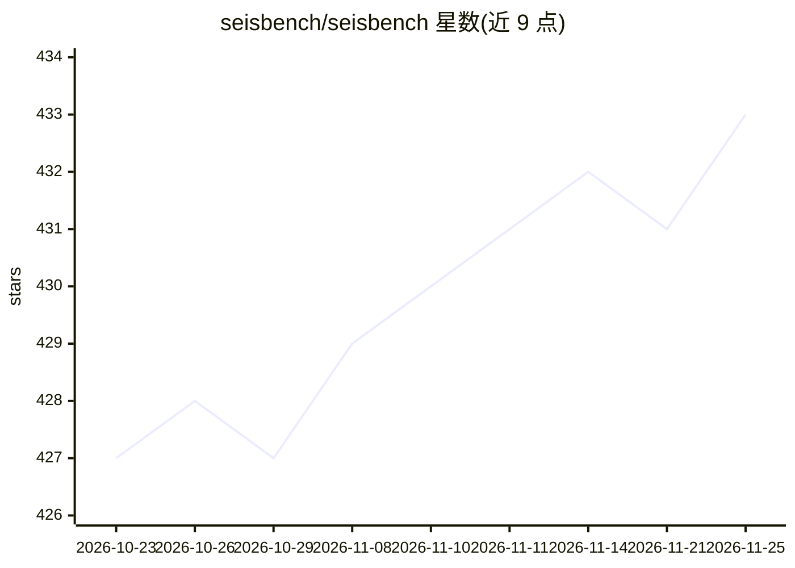

# seisbench/seisbench

⭐ 433 · Jupyter Notebook · GPL-3.0 · 推送 2026-11-17 · [GitHub](https://github.com/seisbench/seisbench) · 组织维护

**为地震学研究者提供机器学习统一工具箱**

开源 Python 工具箱，提供访问地震数据集、训练与应用机器学习模型的统一 API，旨在降低地震学任务中应用或开发机器学习技术的开销。包含三个核心模块：data（访问与加载基准数据集）、models（创建、加载预训练或训练地震学模型）、generate（构建数据生成管道）。通过 PyPI 或源码安装，基于 PyTorch 构建，可选用 CUDA 加速，提供 Colab 教程覆盖震相拾取、去噪、目录构建、DAS 数据等主题。

## 筛选速览

| 维度 | 判定 | 备注 |
|---|---|---|
| AI 角色 | `ai-native` | 本体是模型或模型工具 |
| 许可风险 | `viral` | GPL-3.0 |
| 部署形态 | `library` | 以包/库形式分发 |
| 模型依赖 | — | README 未给出锁定关系 |
| 硬件要求 | — | 无带数字的原话,不猜 |
| 安装摩擦 | `medium` | 含编译或系统依赖之一 |
| 成熟度 | — | 结构信号不足 |

## 能力要点

- data/models/generate 三模块统一 API：数据集、模型、生成管道
- 可创建、加载预训练或在任意数据集上训练地震学模型
- 提供 Colab 教程，覆盖震相拾取、去噪、地震目录构建、DAS 数据
- 支持备份仓库切换以应对主仓库访问问题

## 适用场景

- 加载地震基准数据集并训练震相拾取模型
- 用预训练模型对地震数据做拾取、去噪或深度估计
- 为分布式声波传感（DAS）数据训练和应用模型
- 构建地震事件目录

## 场景标签

`教程课程` `科研工具` · 领域:学习与行业

## 证据(README 行号)

> L8: The Seismology Benchmark collection (*SeisBench*) is an open-source python toolbox for
> L10: It provides a unified API for accessing seismic datasets and both training and applying machine learning algorithms
> L17: `models` offers a collection of machine learning models for seismology.

## 星数曲线

2026-10-23 427 → 2026-11-25 433（+6）

---
*卡片 v1 · prompt 1.4 · 生成 2026-11-25 · 置信度 high · 依据 README sha `20efe0c54cfe` · [字段定义](../../DATASET.md)*
