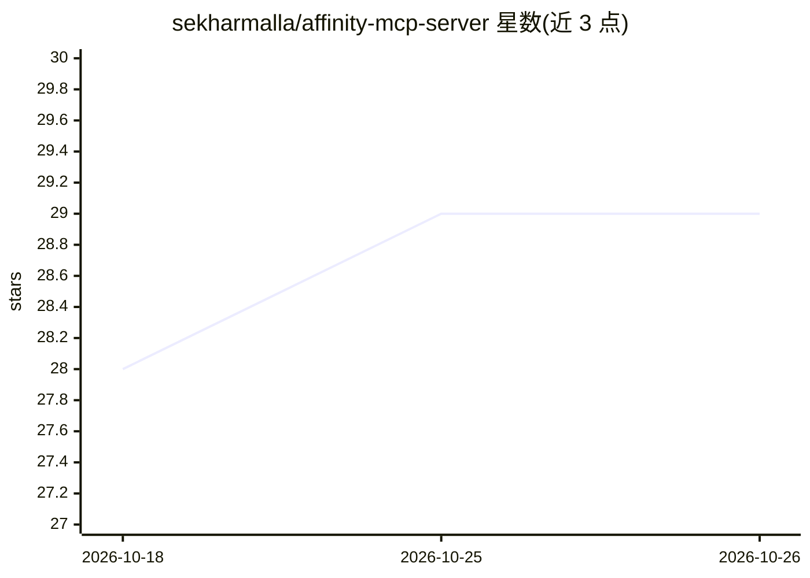

# sekharmalla/affinity-mcp-server

⭐ 29 · TypeScript · MIT · 推送 2026-07-03 · [GitHub](https://github.com/sekharmalla/affinity-mcp-server) · 个人维护

**让 AI 助手通过 MCP 控制 macOS 上 Affinity 设计套件的服务器**

基于 TypeScript 的 MCP 服务器，通过 AppleScript 与 System Events 让 Claude 等 AI 客户端操作 Affinity（Canva 统一版）：提供 23 个工具覆盖应用生命周期、文件打开/导出、菜单导航（4 级深度）、UI 检查与点击、键盘鼠标输入、图层/滤镜/宏、截图等。支持 Claude Code、Claude Desktop、Cursor、VS Code 四种客户端配置，可一键安装为 Claude Code 插件并附带 affinity-design 技能。限制：仅 macOS、需 Bun 运行时与辅助功能/屏幕录制权限，App Store 版进程名硬编码。

## 筛选速览

| 维度 | 判定 | 备注 |
|---|---|---|
| AI 角色 | `ai-ecosystem` | LLM/agent 周边工具 |
| 许可风险 | `permissive` | MIT |
| 部署形态 | `None` |  |
| 模型依赖 | — | README 未给出锁定关系 |
| 硬件要求 | — | 无带数字的原话,不猜 |
| 安装摩擦 | `low` | 无编译、无系统依赖或容器化 |
| 成熟度 | — | 结构信号不足 |

## 能力要点

- 23 个 MCP 工具覆盖 Affinity 完整工作流（菜单/UI/输入/文档/图层/滤镜/截图）
- stdio 接收 MCP 调用后翻译为 AppleScript 经 osascript 执行
- 可安装为 Claude Code 插件并附带 affinity-design 工作流技能
- 支持 Claude Code / Claude Desktop / Cursor / VS Code 四种客户端配置

## 适用场景

- 让 Claude 等 AI 助手用自然语言完成 Affinity 设计与导出任务
- 通过 AI 自动化设计软件的菜单操作与文件批处理流程
- 为 AI 客户端接入 macOS 专业设计软件的控制通道

## 场景标签

`GUI 自动化` · 领域:效率与自动化

## 证据(README 行号)

> L16: An MCP (Model Context Protocol) server that gives AI assistants like Claude full control over the **Affinity** crea
> L175: AI Client  ──stdio──>  MCP Server  ──execSync──>  osascript  ──AppleScript──>  System Events  ──>  Affinity

## 星数曲线

2026-10-18 28 → 2026-10-26 29（+1）

---
*卡片 v1 · prompt 1.4 · 生成 2026-10-26 · 置信度 high · 依据 README sha `37dad37715e3` · [字段定义](../../DATASET.md)*
