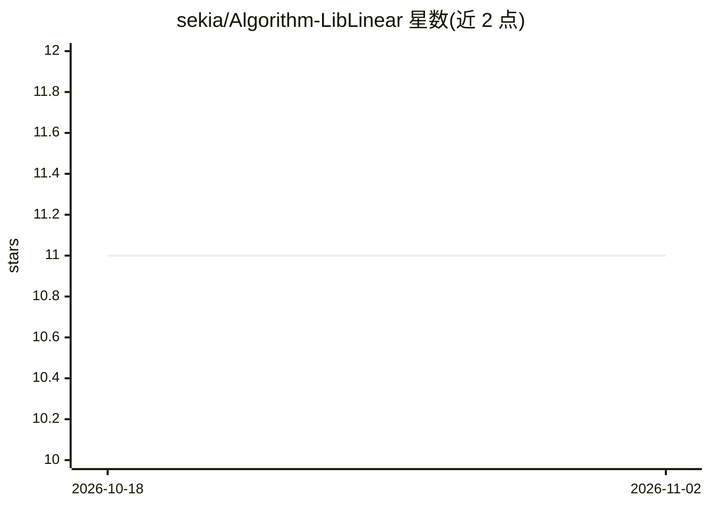

# sekia/Algorithm-LibLinear

⭐ 11 · C++ · 推送 2026-06-14 · [GitHub](https://github.com/sekia/Algorithm-LibLinear) · 个人维护

**LIBLINEAR 的 Perl XS 绑定：线性 SVM 分类/回归/异常检测**

以 XS 方式封装 C/C++ 库 LIBLINEAR（兼容 2.48 版）的 Perl 模块，提供线性 SVM 与逻辑回归的分类、回归及 One-class SVM 异常检测能力。用户以面向对象接口创建 learner，设置 cost、epsilon、solver（覆盖 11 种分类、3 种回归与 1 种单类求解器）及类别权重，可进行 N 折交叉验证、超参数自动寻优（仅限三种 solver）与训练预测。find_cost_parameter 方法已标记废弃，由 find_parameters 取代。

## 筛选速览

| 维度 | 判定 | 备注 |
|---|---|---|
| AI 角色 | `ai-native` | 本体是模型或模型工具 |
| 许可风险 | `none` | — |
| 部署形态 | `None` |  |
| 模型依赖 | — | README 未给出锁定关系 |
| 硬件要求 | — | 无带数字的原话,不猜 |
| 安装摩擦 | `low` | 无编译、无系统依赖或容器化 |
| 成熟度 | — | 结构信号不足 |

## 能力要点

- 11 种分类、3 种回归、1 种单类 SVM 求解器
- N 折交叉验证与 cost/loss_sensitivity 超参数自动寻优
- 类别权重调整，用于处理训练集类别不平衡
- XS 绑定直接调用 LIBLINEAR 2.48 的 C/C++ 实现

## 适用场景

- 在 Perl 程序中训练线性 SVM 或逻辑回归模型
- 对标注数据集做交叉验证评估与超参数调优
- 处理带类别不平衡的二分类/多分类任务

## 场景标签

 · 领域:机器学习/传统ML

## 证据(README 行号)

> L3: Algorithm::LibLinear - A Perl binding for LIBLINEAR, a library for classification, regression, and outlier detection
> L45: C<Algorithm::LibLinear> is an XS binding for LIBLINEAR, a fast C/C++ library for linear classification, regression,

## 星数曲线

2026-10-18 11 → 2026-11-02 11（+0）

---
*卡片 v1 · prompt 1.4 · 生成 2026-11-01 · 置信度 high · 依据 README sha `fdf2f817dcfc` · [字段定义](../../DATASET.md)*
