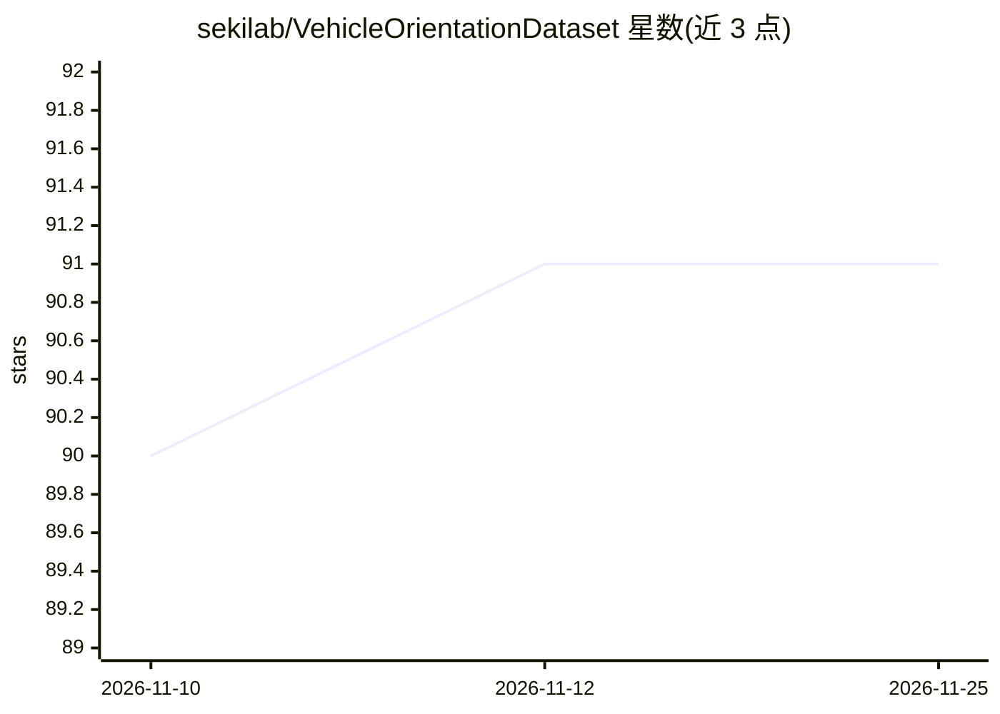

# sekilab/VehicleOrientationDataset

⭐ 91 · MIT · 推送 2026-11-10 · [GitHub](https://github.com/sekilab/VehicleOrientationDataset) · 组织维护

**车辆朝向检测数据集：20万图像百万级标注**

大规模车辆检测数据集，包含 20 万余张图像中的 100 万余条标注，同时提供车辆类别（5 类）与朝向（前/后/侧）标签，共 15 个组合类别，可减少为朝向分类额外训练第二个网络的需要。标注采用 YOLO（darknet）格式，数据约 100GB，托管于 AWS S3 东京节点并分 5 个部分下载。另提供在 YOLOv4/YOLOv5 上训练的预训练权重下载，以及实验视频与 GPS 数据。面向智能交通与车辆检测研究场景。

## 筛选速览

| 维度 | 判定 | 备注 |
|---|---|---|
| AI 角色 | `ai-knowledge` | 知识聚合/清单类 |
| 许可风险 | `permissive` | MIT |
| 部署形态 | `None` |  |
| 模型依赖 | — | README 未给出锁定关系 |
| 硬件要求 | — | 无带数字的原话,不猜 |
| 安装摩擦 | `low` | 无编译、无系统依赖或容器化 |
| 成熟度 | — | 结构信号不足 |

## 能力要点

- 20万余张图像、100万余条车辆类别+朝向标注
- 5 类车辆 × 3 种朝向共 15 个组合类别，标注呈长尾分布
- 提供 YOLOv4/YOLOv5 预训练权重与实验视频/GPS 数据
- 标注为 YOLO（darknet）格式，数据集分 5 部分托管于 AWS S3

## 适用场景

- 训练同时做车辆检测与朝向分类的目标检测模型
- 交通流重构与交通监控研究的数据基础
- 参加车辆类别与朝向检测竞赛

## 场景标签

`目标检测` · 领域:感知与多模态

## 证据(README 行号)

> L13:  The vehicle orientation dataset contains more than one million annotations of vehicles with orientation in more th
> L57: The vehicle orientation dataset is hosted on AWS S3 (Asia-pacific, Tokyo) bucket. Since the overall size of the dat

## 星数曲线

2026-11-10 90 → 2026-11-25 91（+1）

---
*卡片 v1 · prompt 1.4 · 生成 2026-11-17 · 置信度 high · 依据 README sha `b2bf376c56eb` · [字段定义](../../DATASET.md)*
