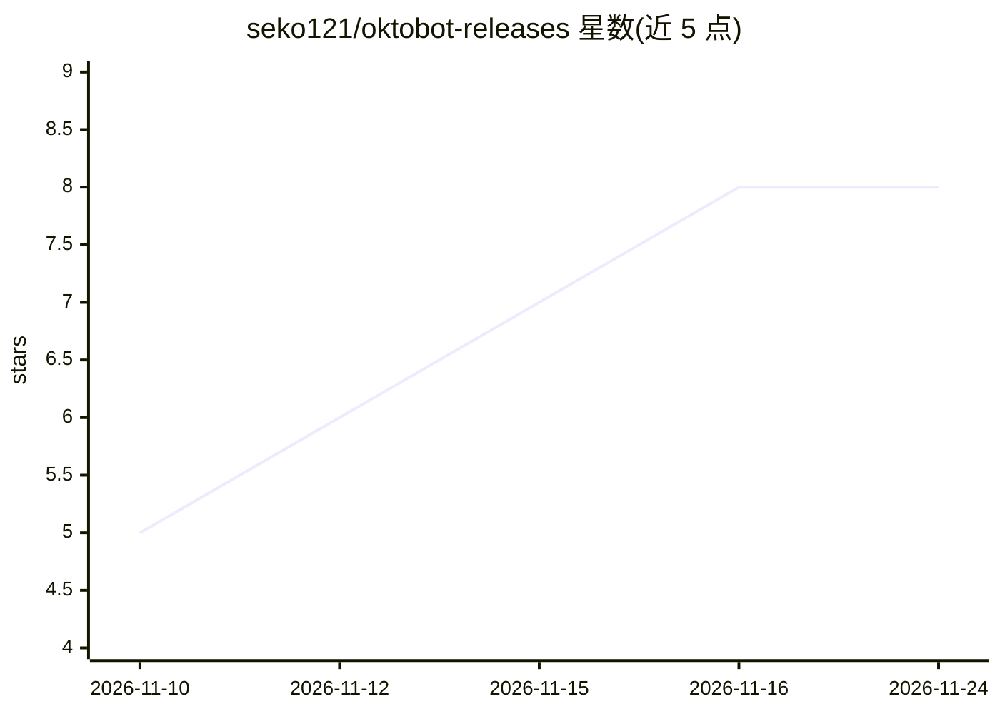

# seko121/oktobot-releases

⭐ 8 · 推送 2026-11-19 · [GitHub](https://github.com/seko121/oktobot-releases) · 个人维护

**安卓端 AI agent：代用户操作手机完成任务**

面向 Android 的 AI agent 应用：用户给出目标后，它通过 Accessibility 服务或 Shizuku/ADB 驱动手机逐步执行搜索、浏览、打开应用等操作。功能包括 AI 浏览器、语音/视频通话、图像生成与编辑、记忆、MCP 服务器接入、Agent Skills（SKILL.md 格式）、定时任务与设备内 Linux 沙盒。模型来源由用户选择：自备云端 API key、ChatGPT/Claude 订阅登录或设备端模型。项目闭源，本仓库仅托管签名 APK、发布说明与文档，支持 Google Play、GitHub Releases 与 Obtainium 获取。

## 筛选速览

| 维度 | 判定 | 备注 |
|---|---|---|
| AI 角色 | `ai-native` | 本体是模型或模型工具 |
| 许可风险 | `none` | — |
| 部署形态 | `desktop` | 安装包/桌面程序 |
| 模型依赖 | — | README 未给出锁定关系 |
| 硬件要求 | — | 无带数字的原话,不猜 |
| 安装摩擦 | `low` | 无编译、无系统依赖或容器化 |
| 成熟度 | — | 结构信号不足 |

## 能力要点

- 通过 Accessibility 或 Shizuku/ADB 控制手机执行多步任务
- 支持 MCP 服务器与 Claude/OpenClaw 格式的 Agent Skills（含 ClawHub 安装与安全检查）
- 多模型接入：云 API key、ChatGPT/Claude 订阅登录或设备端模型
- 无账号无服务器，对话与记忆留在设备本地

## 适用场景

- 让 agent 代为在手机上搜索、浏览、打开应用完成任务
- 接入自己的 API key 或订阅在安卓上使用多模型 agent
- 用语音/视频通话与 agent 交互并生成或编辑图片

## 场景标签

`GUI 自动化` `AI 助手` `图像生成` · 领域:效率与自动化

## 证据(README 行号)

> L5: **An AI agent for Android that works for you, not just chats.** Give it a goal and it searches, browses, opens apps 
> L19: - **Controls your phone.** Opens apps, taps, swipes, types and reads the screen through the Accessibility service (

## 星数曲线

2026-11-10 5 → 2026-11-24 8（+3）

---
*卡片 v1 · prompt 1.4 · 生成 2026-11-20 · 置信度 high · 依据 README sha `cf0d5d7b9d58` · [字段定义](../../DATASET.md)*
