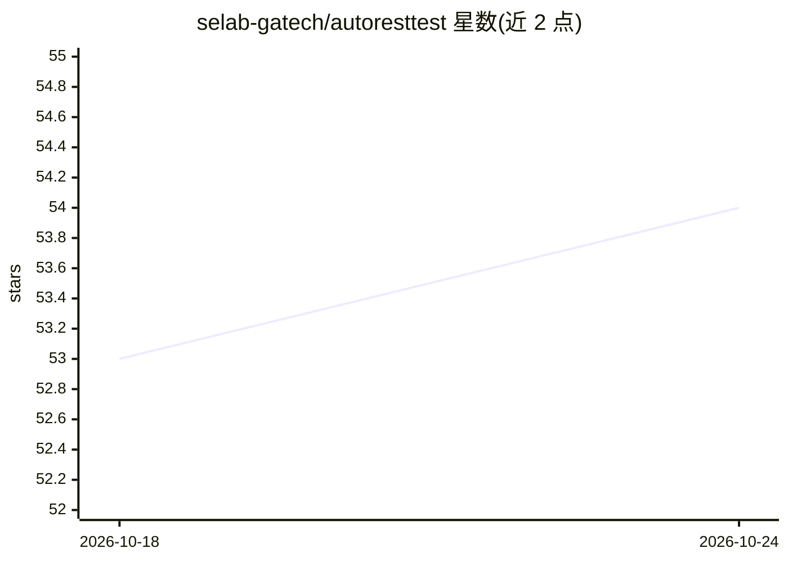

# selab-gatech/autoresttest

⭐ 54 · HTML · MIT · 推送 2026-10-10 · [GitHub](https://github.com/selab-gatech/autoresttest) · 组织维护

**面向测试人员的自动化 REST API 黑盒测试工具**

AutoRestTest 解析 OpenAPI 3.0 规范，结合图论、LLM 与多智能体强化学习（Q-learning）自动生成并执行 REST API 测试用例，输出测试结果。LLM 用于构建强化学习表与图边，支持任意 OpenAI-API 兼容提供商（OpenAI、OpenRouter、Azure OpenAI 及 LocalAI、LM Studio、vLLM、Ollama 等本地模型），要求模型支持 JSON 模式且需 API key（本地无 key 模型除外）。以 Poetry 管理 Python 3.10.x 项目从源码运行，通过单个 TOML 文件配置规范、Q-learning 参数与 LLM；按时间预算限制 RL 迭代，可缓存图与 Q 表以降低重复运行成本，并附带本地被测服务脚本（部分需 JDK 构建）。

## 筛选速览

| 维度 | 判定 | 备注 |
|---|---|---|
| AI 角色 | `ai-enhanced` | 去掉 AI 部分产品仍成立 |
| 许可风险 | `permissive` | MIT |
| 部署形态 | `self-host` | docker 或自建部署 |
| 模型依赖 | local-ok | 支持本地模型 |
| 硬件要求 | — | 无带数字的原话,不猜 |
| 安装摩擦 | `low` | 无编译、无系统依赖或容器化 |
| 成熟度 | — | 结构信号不足 |

## 能力要点

- 解析 OpenAPI 3.0 规范并基于图建模与 MARL（Q-learning）生成测试用例
- 支持任意 OpenAI-API 兼容 LLM 提供商（含 LocalAI/LM Studio/vLLM/Ollama 本地模型）
- 深度加权分层采样限制参数组合规模（默认上限 3000 组合/操作）
- 可缓存图与 Q 表，重复运行降低成本

## 适用场景

- 对自有 REST API 自动生成黑盒测试用例
- 使用本地 LLM（Ollama/vLLM 等）离线跑 API 测试
- 配合内置 OpenAPI 规范集批量测试常用公开 API

## 场景标签

 · 领域:软件测试/自动化

## 证据(README 行号)

> L4: ***AutoRestTest*** is a complete testing software for automated API testing that combines the utility of graph
> L5: theory, Large Language Models (LLMs), and multi-agent reinforcement learning (MARL) to parse the OpenAPI Specificati
> L18: The program uses LLMs for natural-language processing during the creation of the reinforcement
> L19: learning tables and graph edges. AutoRestTest supports any LLM from an OpenAI-API compatible provider, including Op

## 星数曲线

2026-10-18 53 → 2026-10-24 54（+1）

---
*卡片 v1 · prompt 1.4 · 生成 2026-10-24 · 置信度 mid · 依据 README sha `a88ccfc40fe5` · [字段定义](../../DATASET.md)*
