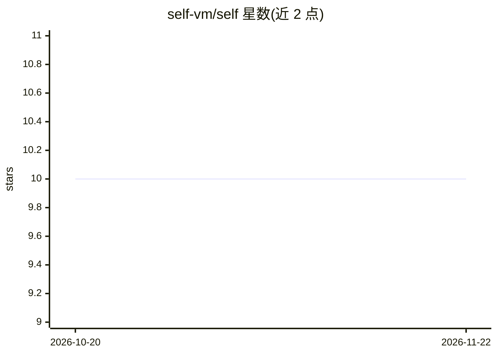

# self-vm/self

⭐ 10 · Rust · MIT · 推送 2026-04-07 · [GitHub](https://github.com/self-vm/self) · [官网](https://selfvm.run) · 个人维护

**在 ISA 与标准库层面原生集成 AI 指令的虚拟机**

用 Rust（Cargo）编写的虚拟机，将 AI 作为 ISA 与标准库的一部分集成：标准库提供 ai、fs、http、net、os、schedule 等 13 个原生模块。目前无预打包发布版，需运行 build.sh 从源码构建。路线图包含扩展 Web.Browser、创建 Html 结构以支持向 LLM 注入的优化操作，以及面向 LLM 的参数配置系统。

## 筛选速览

| 维度 | 判定 | 备注 |
|---|---|---|
| AI 角色 | `ai-ecosystem` | LLM/agent 周边工具 |
| 许可风险 | `permissive` | MIT |
| 部署形态 | `None` |  |
| 模型依赖 | — | README 未给出锁定关系 |
| 硬件要求 | — | 无带数字的原话,不猜 |
| 安装摩擦 | `low` | 无编译、无系统依赖或容器化 |
| 成熟度 | — | 结构信号不足 |

## 能力要点

- AI 集成位于 ISA 与标准库层面
- 标准库含 13 个原生模块（ai/fs/http/net/os 等）
- 路线图包含面向 LLM 的参数定义与 Html 注入优化

## 适用场景

- 在虚拟机指令层直接调用 AI 能力
- 以统一 stdlib 方式使用文件、网络与 AI 模块

## 场景标签

 · 领域:系统软件/虚拟机

## 证据(README 行号)

> L3: self is a virtual machine with native AI integration at the ISA and standard library level.
> L7:  - ai

## 星数曲线

2026-10-20 10 → 2026-11-22 10（+0）

---
*卡片 v1 · prompt 1.4 · 生成 2026-11-19 · 置信度 mid · 依据 README sha `44c406047957` · [字段定义](../../DATASET.md)*
