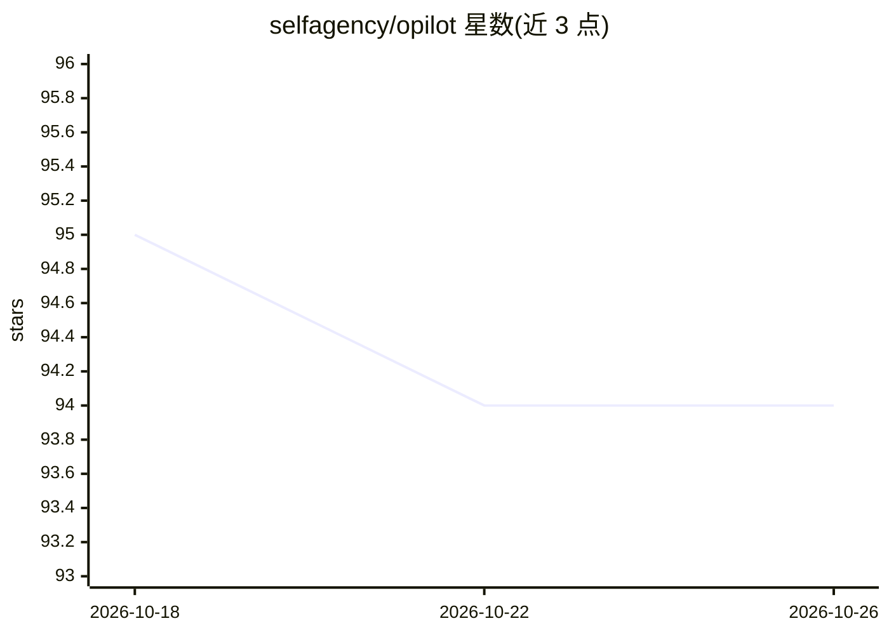

# selfagency/opilot

⭐ 94 · TypeScript · MIT · 推送 2026-07-16 · [GitHub](https://github.com/selfagency/opilot) · [官网](http://opilot.self.agency/) · 个人维护

**在 GitHub Copilot Chat 中接入 Ollama 本地/云模型的 VS Code 扩展**

面向 VS Code + GitHub Copilot Chat 用户的扩展：把 Ollama 生态（本地模型、云端模型、模型库）接入 Copilot Chat，提供 `@ollama` 聊天参与者、模型选择器、内联代码补全（FIM）、工具调用、视觉输入与思考模型支持。侧边栏可拉取/运行/停止/删除模型并调节逐模型生成参数，Modelfile 管理器带语法高亮与自动补全。本地模型完全在机器上运行，不发送数据到外部服务。依赖 VS Code 1.111+、Copilot Chat 与 Ollama 本地或远程实例，MIT 许可，由个人维护。

## 筛选速览

| 维度 | 判定 | 备注 |
|---|---|---|
| AI 角色 | `ai-ecosystem` | LLM/agent 周边工具 |
| 许可风险 | `permissive` | MIT |
| 部署形态 | `library` | 以包/库形式分发 |
| 模型依赖 | local-ok | 支持本地模型 |
| 硬件要求 | — | 无带数字的原话,不猜 |
| 安装摩擦 | `low` | 无编译、无系统依赖或容器化 |
| 成熟度 | — | 结构信号不足 |

## 能力要点

- `@ollama` 聊天参与者与 Copilot Chat 模型选择器接入 Ollama 模型
- 模型管理侧边栏：拉取/运行/停止/删除模型，显示 VRAM 用量与能力徽章
- 内联代码补全（FIM）、工具调用（MCP/VS Code 命令）、视觉与思考模型支持
- 本地运行不发送数据到外部服务，远程令牌存于 VS Code 加密 secrets API

## 适用场景

- 在 Copilot Chat 中使用本地 Ollama 模型完成代码问答
- 编辑器内一站式管理 Ollama 模型与 Modelfile
- 用小型本地模型获得内联代码补全

## 场景标签

`代码生成` · 领域:编码与开发

## 证据(README 行号)

> L9: **Opilot** integrates the full Ollama ecosystem — local models, cloud models, and the Ollama model library — directl
> L26: - 💬 **Chat Participant** — Invoke `@ollama` in Copilot Chat for a dedicated, history-aware conversation with your c
> L29: - 🔧 **Tool Calling** — Full tool/function-calling support for agentic workflows with compatible models (MCP servers

## 星数曲线

2026-10-18 95 → 2026-10-26 94（-1）

---
*卡片 v1 · prompt 1.4 · 生成 2026-10-23 · 置信度 mid · 依据 README sha `3c85e7b24303` · [字段定义](../../DATASET.md)*
