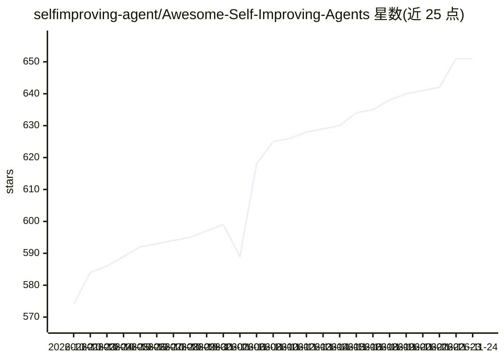

# selfimproving-agent/Awesome-Self-Improving-Agents

⭐ 652 · TeX · MIT · 推送 2026-11-21 · [GitHub](https://github.com/selfimproving-agent/Awesome-Self-Improving-Agents) · [官网](https://selfimproving-agent.github.io/) · 组织维护

**面向研究者的自改进智能体论文与资源策展清单**

伴随综述论文《Self-Improvements in Modern Agentic Systems: A Survey》的资源仓库，收录论文、基准、博客、播客、访谈、视频、工作坊与课程等资料。按双重分类法组织：基础模型改进（内在生成演示、内在评估反馈、外在探索经验）与脚手架改进（提示词、记忆、工具、完整脚手架）。以论文清单表格形式呈现条目，含年份、发表场所、论文与代码链接，接受社区 PR 投稿。MIT 许可，附 Discord 社区与项目主页。

## 筛选速览

| 维度 | 判定 | 备注 |
|---|---|---|
| AI 角色 | `ai-knowledge` | 知识聚合/清单类 |
| 许可风险 | `permissive` | MIT |
| 部署形态 | `None` |  |
| 模型依赖 | — | README 未给出锁定关系 |
| 硬件要求 | — | 无带数字的原话,不猜 |
| 安装摩擦 | `medium` | 含编译或系统依赖之一 |
| 成熟度 | — | 结构信号不足 |

## 能力要点

- 按基础模型改进与脚手架改进双轴组织的分类法
- 每条论文含年份、发表场所、论文与代码链接
- 配套 arXiv 综述论文与动画化概念讲解
- 接受社区 PR 持续扩充资源

## 适用场景

- 查找自改进智能体方向的论文与代码实现
- 了解该领域的发展脉络与代表系统时间线
- 为研究选题梳理分类框架

## 场景标签

`精选清单` · 领域:学习与行业

## 证据(README 行号)

> L3:  A curated and continuously evolving resource hub for self-improving agentic systems
> L54:  Self-Improvements in Modern Agentic Systems: A Survey
> L134: |📅 Year|📝 Title|🏛️ Venue|📄 Paper|💻 Code|

## 星数曲线

2026-10-21 574 → 2026-11-24 651（+77）

---
*卡片 v1 · prompt 1.4 · 生成 2026-11-24 · 置信度 high · 依据 README sha `eed8bfda4580` · [字段定义](../../DATASET.md)*
