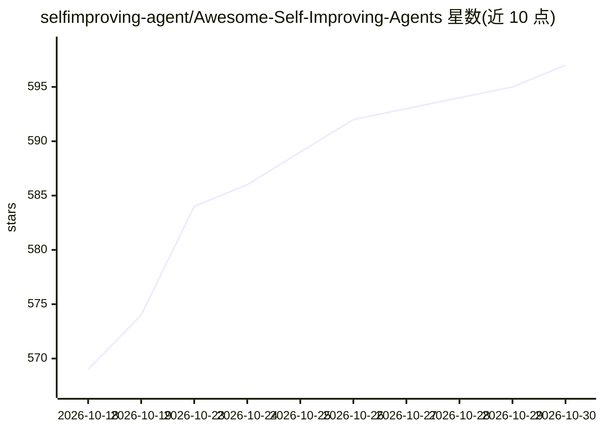

# selfimproving-agent/Awesome-Self-Improving-Agents

⭐ 597 · TeX · MIT · 推送 2026-10-28 · [GitHub](https://github.com/selfimproving-agent/Awesome-Self-Improving-Agents) · [官网](https://selfimproving-agent.github.io/) · 组织维护

**自我改进智能体系统论文与资源的策展清单**

伴随综述论文《Self-Improvements in Modern Agentic Systems: A Survey》维护的资源库，收录论文、基准、博客、播客、访谈、视频与课程等资源。内容按两大类组织：基础模型改进（内在生成示范、内在评估反馈、外部探索经验）与脚手架改进（提示优化、记忆、工具、完整脚手架），下设多个子类的时间排序论文表，含年份、会议、论文与代码链接。面向该领域研究者的文献导航，接受社区 PR 贡献，提供 arXiv 论文、Hugging Face Daily Papers 与项目页入口。

## 筛选速览

| 维度 | 判定 | 备注 |
|---|---|---|
| AI 角色 | `ai-knowledge` | 知识聚合/清单类 |
| 许可风险 | `permissive` | MIT |
| 部署形态 | `None` |  |
| 模型依赖 | — | README 未给出锁定关系 |
| 硬件要求 | — | 无带数字的原话,不猜 |
| 安装摩擦 | `medium` | 含编译或系统依赖之一 |
| 成熟度 | — | 结构信号不足 |

## 能力要点

- 以综述论文为基础的持续更新资源库
- 双轴分类：基础模型改进与脚手架改进，含多个子类
- 论文表含年份、发表会议、代码链接
- 收录论文/基准/博客/播客/访谈/视频/课程等多类资源

## 适用场景

- 系统查阅自我改进智能体方向的论文脉络
- 按子类（如记忆改进、工具学习）定位相关工作与代码
- 配套综述论文了解分类体系定义

## 场景标签

`精选清单` `科研工具` · 领域:学习与行业

## 证据(README 行号)

> L3:  A curated and continuously evolving resource hub for self-improving agentic systems
> L6:  📄 Papers · 📊 Benchmarks · ✍️ Blogs · 🎙️ Podcasts ·
> L52:  This repository accompanies

## 星数曲线

2026-10-18 569 → 2026-10-30 597（+28）

---
*卡片 v1 · prompt 1.4 · 生成 2026-10-22 · 置信度 high · 依据 README sha `f126d5c649f3` · [字段定义](../../DATASET.md)*
