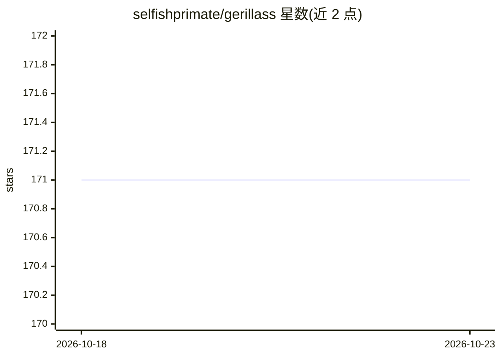

# selfishprimate/gerillass

⭐ 171 · SCSS · NOASSERTION · 推送 2026-10-16 · [GitHub](https://github.com/selfishprimate/gerillass) · [官网](https://gerillass.com/) · 个人维护

**供编码代理读取的 Sass mixin/函数库**

基于 Sass 的 mixin 与函数库，面向前端开发者生成可扩展的 CSS 输出，覆盖 Vite、webpack、Parcel、Next.js、Angular、Gulp、Grunt、Rails/Jekyll 等构建工具的接入配方，同时以 npm 包和 Ruby gem 双渠道分发。特色机制：每个 mixin 和函数附带机器可读的 manifest（gerillass.json）与生成的 SKILL.md，供 AI 编码代理正确调用；测试套件编译 manifest 中的全部示例并验证拒绝行为，防止文档与代码漂移。自 v1.3.0 起不支持已弃用的 LibSass，需使用 Dart Sass。

## 筛选速览

| 维度 | 判定 | 备注 |
|---|---|---|
| AI 角色 | `ai-enhanced` | 去掉 AI 部分产品仍成立 |
| 许可风险 | `none` | NOASSERTION |
| 部署形态 | `library` | 以包/库形式分发 |
| 模型依赖 | — | README 未给出锁定关系 |
| 硬件要求 | — | 无带数字的原话,不猜 |
| 安装摩擦 | `low` | 无编译、无系统依赖或容器化 |
| 成熟度 | — | 结构信号不足 |

## 能力要点

- 每个 mixin/函数附带机器可读 manifest（gerillass.json）与生成的 SKILL.md
- 测试套件编译并验证 manifest 中所有示例与拒绝行为，防止文档漂移
- npm 包与 Ruby gem 双渠道分发，覆盖主流构建工具接入配方
- 三种调用方式（裸名/gls- 前缀/命名空间）产出相同 CSS

## 适用场景

- 前端项目中复用 mixin 加速样式编写
- 让 AI 编码代理通过 SKILL.md 正确使用库的参数形式
- 在 Vite/webpack/Rails 等不同构建链中引入同一套 Sass 工具

## 场景标签

 · 领域:前端开发/CSS 工具库

## 证据(README 行号)

> L9: It is also built to be read by coding agents. Every mixin and function ships with a machine-readable manifest, and t
> L227: **`gerillass.json`** describes every mixin and function: its signature, what each argument accepts, examples that 
> L231: **`SKILL.md`** is a written guide generated from that manifest. It covers how to load the library, the full catalo

## 星数曲线

2026-10-18 171 → 2026-10-23 171（+0）

---
*卡片 v1 · prompt 1.4 · 生成 2026-10-22 · 置信度 high · 依据 README sha `66b221ccba3f` · [字段定义](../../DATASET.md)*
