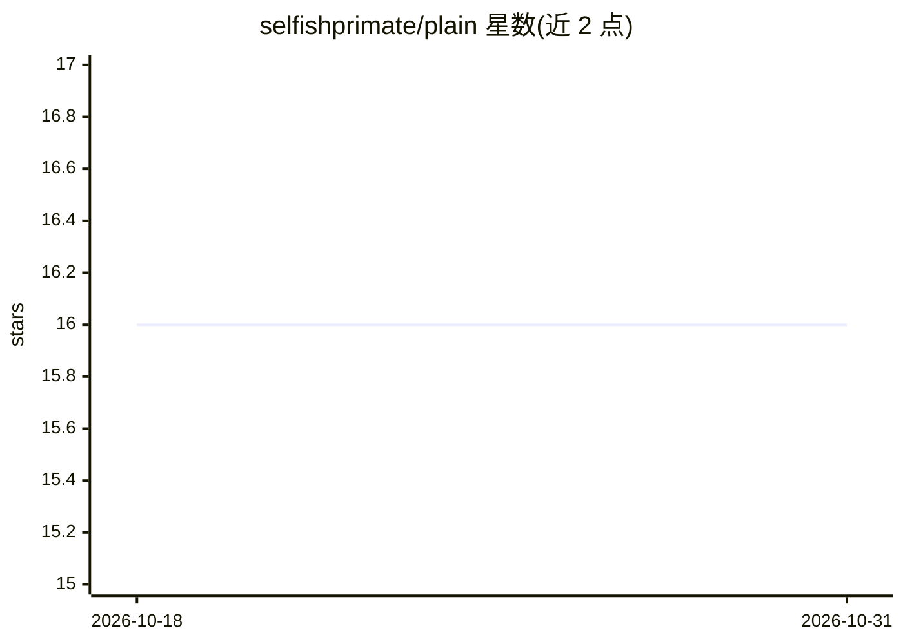

# selfishprimate/plain

⭐ 16 · MIT · 推送 2026-07-23 · [GitHub](https://github.com/selfishprimate/plain) · [官网](https://plainify.app) · 个人维护

**面向产品经理与开发者的结构化 markdown 产品规格格式，供 AI 工具生成代码**

PLAIN 是一种结构化 markdown 规格格式，把产品愿景、设计方向、MoSCoW 需求、技术架构等整合为单一 AI 可读文档，供 Claude、Gemini、Cursor、v0、Bolt 等工具据此生成 UI、代码与文档。使用方式：下载模板手动填写，或安装 agent 技能（Claude Code/Gemini CLI/Codex CLI 各有 curl 安装命令）由 agent 生成规格文件；另提供 Plainify 网页应用，通过分节引导与 LLM 处理生成 PLAIN 文件。规格中可写 'Let AI decide for me' 交由 AI 选型。MIT 许可。

## 筛选速览

| 维度 | 判定 | 备注 |
|---|---|---|
| AI 角色 | `ai-ecosystem` | LLM/agent 周边工具 |
| 许可风险 | `permissive` | MIT |
| 部署形态 | `None` |  |
| 模型依赖 | locked-api |  |
| 硬件要求 | — | 无带数字的原话,不猜 |
| 安装摩擦 | `low` | 无编译、无系统依赖或容器化 |
| 成熟度 | — | 结构信号不足 |

## 能力要点

- 单一 markdown 文件整合设计、需求与技术架构，供 AI 工具读取生成代码
- 提供 Claude Code / Gemini CLI / Codex CLI 三种 agent 技能安装命令，可由 agent 自动生成规格文件
- MoSCoW 优先级与 User Stories 结构化记录需求
- 'Let AI decide for me' 占位语法，交由 AI 补全不确定的技术选择

## 适用场景

- 产品经理把想法写成结构化规格后交给 AI 工具直接生成应用
- 设计师在规格中固定配色、字体等设计方向，约束 AI 生成 UI 的风格
- 独立开发者/小团队对不熟悉的技术决策使用 AI 推荐选项

## 场景标签

`提示工程` `代码生成` · 领域:Agent 开发

## 证据(README 行号)

> L3: **PLAIN** is a structured markdown format that turns product ideas into machine-readable specs. It bridges the gap b
> L42: Your spec is ready. Feed it to your favorite AI tool with the following command and let it build your application.
> L52: Prefer to skip the template and just describe your idea? Install the PLAIN skill for your AI coding agent, then tel

## 星数曲线

2026-10-18 16 → 2026-10-31 16（+0）

---
*卡片 v1 · prompt 1.4 · 生成 2026-10-30 · 置信度 high · 依据 README sha `cfd3e1743820` · [字段定义](../../DATASET.md)*
