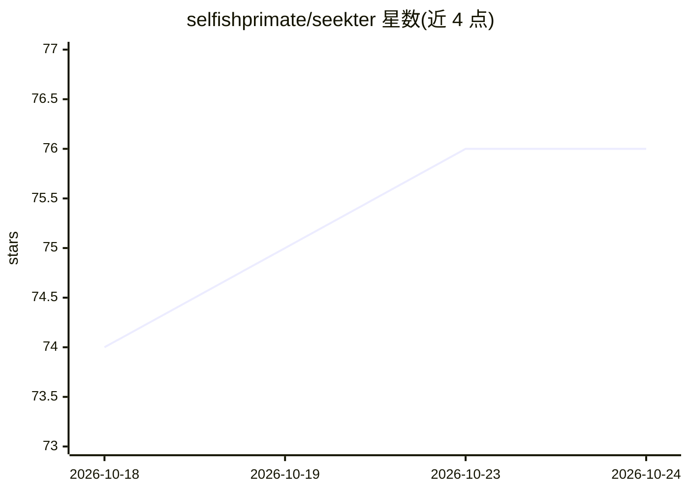

# selfishprimate/seekter

⭐ 76 · JavaScript · MIT · 推送 2026-10-23 · [GitHub](https://github.com/selfishprimate/seekter) · [官网](seekter.dev) · 个人维护

**求职者用的 Claude Code 求职代理：搜索、过滤、代填申请**

运行于 Claude Code 的求职代理工具：每日按固定顺序搜索四个职位来源（用户链接、freehire API、LinkedIn、其他招聘板），依据用户画像规则（地点、签证、薪资、行业、资历、语言）过滤并打 1-5 匹配分，在用户自己的 Chrome 中填写申请表，将每次申请与跳过记录为 markdown 文件供 grep 与 diff。附带面试准备、收件箱扫描归档、漏斗报告、CSV 导入与多版本简历生成等命令。不碰 CAPTCHA、密码和 LinkedIn Easy Apply；运行需付费 Claude 计划或 Anthropic API 账户及 Claude in Chrome 扩展、Node.js 20+。

## 筛选速览

| 维度 | 判定 | 备注 |
|---|---|---|
| AI 角色 | `ai-native` | 本体是模型或模型工具 |
| 许可风险 | `permissive` | MIT |
| 部署形态 | `library` | 以包/库形式分发 |
| 模型依赖 | locked-api |  |
| 硬件要求 | — | 无带数字的原话,不猜 |
| 安装摩擦 | `low` | 无编译、无系统依赖或容器化 |
| 成熟度 | — | 结构信号不足 |

## 能力要点

- 每日搜索四类职位来源，按用户规则过滤并打 1-5 匹配分
- 在用户自己的 Chrome 中填写申请表，跳过 CAPTCHA/密码/LinkedIn Easy Apply
- 所有申请与跳过记录为 markdown 文件，含状态 front matter 与去重表
- 单一主简历（JSON）按角色类型选取要点生成多种 PDF

## 适用场景

- 让 agent 每天替我筛职位并代填申请表
- 用 markdown 文件追踪申请状态、拒信与面试进展
- 为不同岗位类型自动生成侧重点不同的简历 PDF

## 场景标签

`浏览器自动化` · 领域:效率与自动化

## 证据(README 行号)

> L7: A job-search agent for Claude Code. It searches job sources every day, filters postings against **your** rules (loca
> L45: |`/seekter-run`|The daily run. Four sources in a fixed order (links you bring, freehire API, LinkedIn, other boards
> L17: > - Seekter is free, but running it needs a paid Claude plan or an Anthropic API account.

## 星数曲线

2026-10-18 74 → 2026-10-24 76（+2）

---
*卡片 v1 · prompt 1.4 · 生成 2026-10-24 · 置信度 high · 依据 README sha `5db9a7cbb5ea` · [字段定义](../../DATASET.md)*
