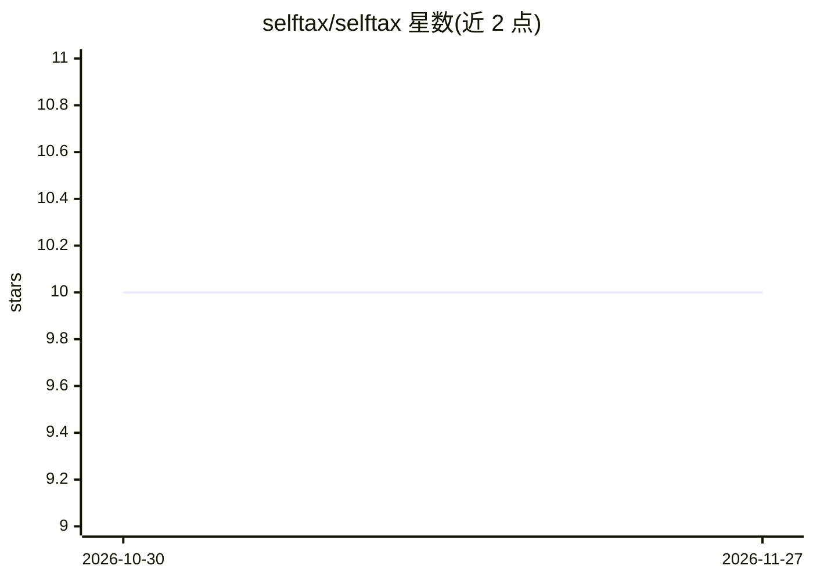

# selftax/selftax

⭐ 10 · TypeScript · NOASSERTION · 推送 2026-04-14 · [GitHub](https://github.com/selftax/selftax) · [官网](https://buymeacoffee.com/selftax) · 个人维护

**本地运行的免费 AI 报税工具：解析税表、计算退税并自动填写免费 IRS 申报站**

Chrome 扩展形式的美国联邦报税工具：读取 W-2/1099 等税务文档，用确定性的开源税务引擎计算应纳税额，并在浏览器中自动填写受支持的免费 IRS 申报站点。AI 仅作为非结构化文档（租金账单、物业管理报告等）的解析器，解析前在本地将姓名、SSN、地址等 PII 替换为 token；结构化表单完全不经过 AI 且不出设备。税务计算为可审计的纯函数代码，明确声明 LLM 不参与任何税务计算。需 Node.js 18+ 与 pnpm 从源码构建加载。

## 筛选速览

| 维度 | 判定 | 备注 |
|---|---|---|
| AI 角色 | `ai-enhanced` | 去掉 AI 部分产品仍成立 |
| 许可风险 | `none` | NOASSERTION |
| 部署形态 | `library` | 以包/库形式分发 |
| 模型依赖 | — | README 未给出锁定关系 |
| 硬件要求 | — | 无带数字的原话,不猜 |
| 安装摩擦 | `low` | 无编译、无系统依赖或容器化 |
| 成熟度 | `idea` | |

## 能力要点

- 确定性税务引擎，逐行可审计，LLM 不参与税务计算
- AI 解析前本地脱敏：姓名/SSN/地址替换为 token
- 结构化 IRS 表单全程浏览器本地处理，零外部调用
- 可作为 MCP server 暴露 5 个税务工具供 Claude Code 调用

## 适用场景

- 免费申报联邦税，替代收费报税软件的数据录入
- 本地处理 W-2/1099 等税务文档而不上传个人数据
- 用 AI 解析租金收入等非标准格式的税务文档
- 通过 Claude Code 以 MCP 方式调用扫描/计算/生成表单工具

## 场景标签

`文档解析` `浏览器自动化` · 领域:效率与自动化

## 证据(README 行号)

> L13: > **AI does NOT do your taxes.** All tax math is deterministic code — pure functions you can read and audit. No LLM
> L15: > AI is used **only** as a document parser for unstructured files (rental statements, property management reports, 
> L113: That's it for simple taxes. Upload your W-2, 1098, or 1099 PDFs and click **Calculate Tax Return**. Everything run

## 星数曲线

2026-10-30 10 → 2026-11-27 10（+0）

---
*卡片 v1 · prompt 1.4 · 生成 2026-11-19 · 置信度 high · 依据 README sha `30c6018c63be` · [字段定义](../../DATASET.md)*
