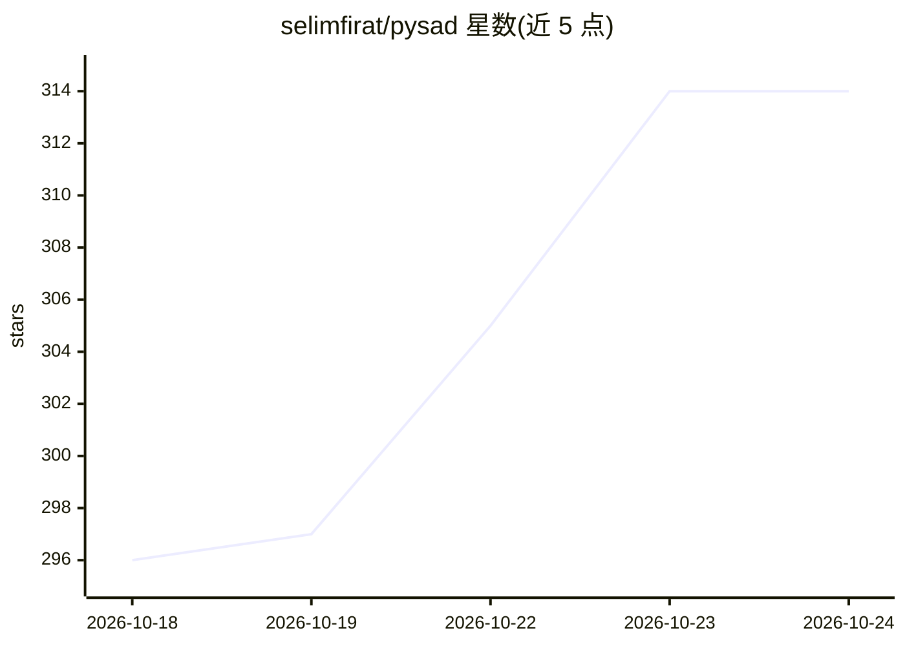

# selimfirat/pysad

⭐ 314 · Python · BSD-3-Clause · 推送 2026-10-22 · [GitHub](https://github.com/selimfirat/pysad) · [官网](https://pysad.readthedocs.io/en/stable/) · 个人维护

**Python 流式异常检测库：逐点打分并校准告警**

面向流数据的异常检测 Python 库：每个数据点到达时即学习并打分（fit_partial/score_partial），内置 16 个来自已发表论文的在线检测器（xStream、LODA、RS-Hash、Half-Space Trees、RRCF 等），配合一致性校准将原始分数转为可比概率并按阈值触发告警；提供预处理、投影、后处理、集成与 AUROC/AUPR 等流式评估指标，另可通过 ReferenceWindowModel 将 PyOD 批量检测器在滑动窗口上运行。pip 单命令安装，支持 Python 3.10-3.14，附 17 个标注基准数据集与论文引用。

## 筛选速览

| 维度 | 判定 | 备注 |
|---|---|---|
| AI 角色 | `ai-native` | 本体是模型或模型工具 |
| 许可风险 | `permissive` | BSD-3-Clause |
| 部署形态 | `library` | 以包/库形式分发 |
| 模型依赖 | — | README 未给出锁定关系 |
| 硬件要求 | — | 无带数字的原话,不猜 |
| 安装摩擦 | `low` | 无编译、无系统依赖或容器化 |
| 成熟度 | — | 结构信号不足 |

## 能力要点

- 16 个来自发表论文的在线检测器，逐点 fit/score
- ConformalProbabilityCalibrator 将分数转为可比概率以触发告警
- 预quential 评估：AUROC/AUPR/精确率/召回率逐点更新
- ReferenceWindowModel 可将任意 PyOD 检测器用于流场景

## 适用场景

- 对传感器或业务指标流实时逐点检测异常并触发告警
- 网络流量入侵检测（KitNet）
- 在滑动窗口上复用已有 PyOD 批量模型处理流数据
- 在 17 个标注数据集上对比检测器效果

## 场景标签

`网络安全` · 领域:学习与行业

## 证据(README 行号)

> L5:  Streaming anomaly detection in Python. PySAD scores each data point when it arrives,
> L41: #### 16 detectors from published papers

## 星数曲线

2026-10-18 296 → 2026-10-24 314（+18）

---
*卡片 v1 · prompt 1.4 · 生成 2026-10-21 · 置信度 high · 依据 README sha `0726f1b97f39` · [字段定义](../../DATASET.md)*
