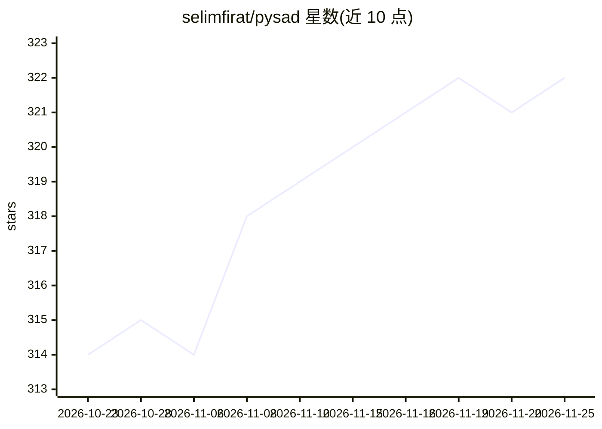

# selimfirat/pysad

⭐ 322 · Python · BSD-3-Clause · 推送 2026-11-23 · [GitHub](https://github.com/selimfirat/pysad) · [官网](https://pysad.readthedocs.io/en/stable/) · 个人维护

**给开发者用的 Python 流式异常检测库，逐点在线检测**

PySAD 是一个面向多变量与单变量数据流的在线异常检测 Python 库，收录 50+ 个来自已发表论文的检测器（LODA、RRCF、Half-Space Trees、xStream、DAMP、SAND 等）。每个数据点到达时即通过 fit_partial/score_partial 更新与打分，无需完整数据集。关键机制包括：Conformal 等校准器将任意原始分数归一到 [0,1] 并配合过滤器生成二值告警、10 种漂移监测器处理概念漂移、prequential 评估框架在 17 个 ODDS 数据集和 58 个 NAB 序列上逐点更新指标。核心用纯 Python/NumPy/SciPy/scikit-learn 实现，无需 JVM；可选 PyO3 Rust 扩展加速部分树模型。以 PyPI 和 conda-forge 发布，支持 Python 3.11-3.14。

## 筛选速览

| 维度 | 判定 | 备注 |
|---|---|---|
| AI 角色 | `ai-native` | 本体是模型或模型工具 |
| 许可风险 | `permissive` | BSD-3-Clause |
| 部署形态 | `library` | 以包/库形式分发 |
| 模型依赖 | — | README 未给出锁定关系 |
| 硬件要求 | — | 无带数字的原话,不猜 |
| 安装摩擦 | `low` | 无编译、无系统依赖或容器化 |
| 成熟度 | — | 结构信号不足 |

## 能力要点

- 50+ 在线单变量/多变量流式检测器，覆盖统计、森林、子序列、图方法
- Conformal/SPOT/高斯尾部校准器将分数归一到 [0,1] 并生成校准告警
- 10 种概念漂移监测器与自动重置的 DriftAdaptiveDetector
- prequential 逐点评估框架，含 17 ODDS 数据集、58 NAB 序列与信用卡欺诈数据

## 适用场景

- 对传感器、网络流量或日志流逐点做实时异常检测
- 信用卡欺诈检测等需要增量学习与漂移处理的场景
- 将告警分数校准后接入现有监控告警系统
- 在 River / scikit-learn / PyOD 管线中嵌入流式检测器

## 场景标签

`网络安全` · 领域:学习与行业

## 证据(README 行号)

> L7:  Streaming anomaly detection in Python for multivariate and univariate data streams.
> L8:  PySAD scores and learns from each point as it arrives, with calibrated alerts, drift handling, and prequential eval
> L45: Batch detectors train on a fixed dataset. Streaming detectors update as points arrive, without waiting for a comple

## 星数曲线

2026-10-23 314 → 2026-11-25 322（+8）

---
*卡片 v1 · prompt 1.4 · 生成 2026-11-25 · 置信度 high · 依据 README sha `7640bc191e64` · [字段定义](../../DATASET.md)*
