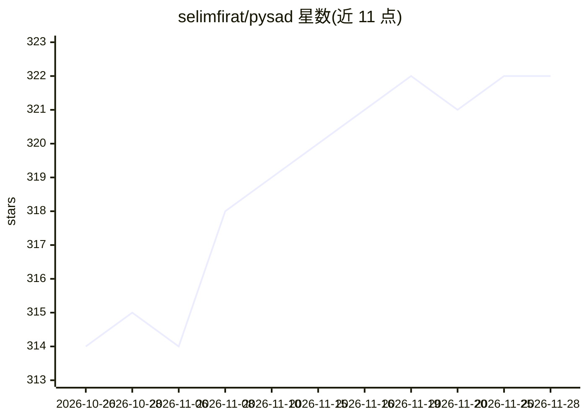

# selimfirat/pysad

⭐ 322 · Python · BSD-3-Clause · 推送 2026-11-27 · [GitHub](https://github.com/selimfirat/pysad) · [官网](https://pysad.readthedocs.io/en/stable/) · 个人维护

**给开发者的 Python 流式异常检测库：50+ 在线检测器逐点打分**

PySAD 是流式异常检测库：数据点到达时逐点学习与打分（fit_partial/score_partial），覆盖多元与单变量数据流，内置 LODA、RRCF、Half-Space Trees、xStream、DAMP、SAND 等 50+ 已发表算法，10 个漂移监测器，以及 conformal/SPOT 等校准器把任意分数归一到 [0,1] 并配阈值过滤产生告警。提供 prequential 评估工具、管道组合（|、&）与 LODA 特征归因。支持 Python 3.11-3.14，核心检测器为纯 NumPy/SciPy 实现，无需 JVM；MCP server 与 Rust 内核为可选组件。

## 筛选速览

| 维度 | 判定 | 备注 |
|---|---|---|
| AI 角色 | `ai-native` | 本体是模型或模型工具 |
| 许可风险 | `permissive` | BSD-3-Clause |
| 部署形态 | `library` | 以包/库形式分发 |
| 模型依赖 | — | README 未给出锁定关系 |
| 硬件要求 | — | 无带数字的原话,不猜 |
| 安装摩擦 | `low` | 无编译、无系统依赖或容器化 |
| 成熟度 | — | 结构信号不足 |

## 能力要点

- 50+ 在线检测器覆盖统计、森林/草图、子序列、图等类别
- Conformal/SPOT/高斯尾校准器统一分数尺度并生成告警
- prequential 评估与流回放器，支持 ODDS/NAB 等标注数据集
- 提供 MCP server（pysad[mcp]）暴露检测器与漂移监测

## 适用场景

- 对传感器或日志数据流逐点检测异常并触发告警
- 处理存在概念漂移的持续数据流监控
- 欺诈检测与入侵检测等流式场景的实验与评估
- 通过 MCP 客户端调用异常检测器做分析

## 场景标签

`网络安全` · 领域:学习与行业

## 证据(README 行号)

> L7:  Streaming anomaly detection in Python for multivariate and univariate data streams.
> L8:  PySAD scores and learns from each point as it arrives, with calibrated alerts, drift handling, and prequential eval
> L51: Every detector learns from and scores one point at a time with `fit_partial`, `score_partial` and `fit_score_partia

## 星数曲线

2026-10-26 314 → 2026-11-28 322（+8）

---
*卡片 v1 · prompt 1.4 · 生成 2026-11-28 · 置信度 high · 依据 README sha `10df2d73df6f` · [字段定义](../../DATASET.md)*
