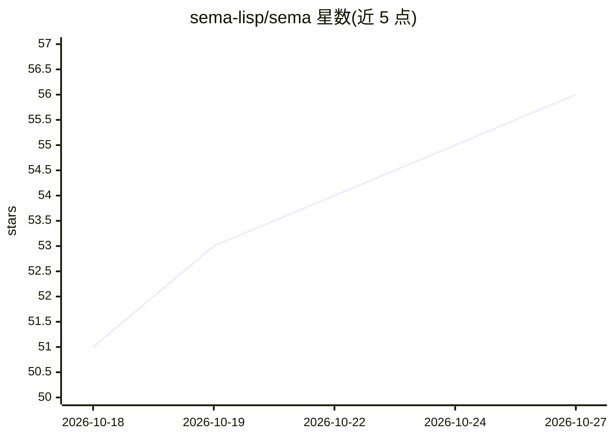

# sema-lisp/sema

⭐ 56 · Rust · MIT · 推送 2026-10-22 · [GitHub](https://github.com/sema-lisp/sema) · [官网](https://sema-lang.com/) · 组织维护

**内置 LLM 原语的 Lisp 语言，供开发者构建 agent 脚本**

用 Rust 实现的 Scheme 风 Lisp，编译为字节码在 VM 上运行，发布为单一二进制。语言将提示、会话、工具、agent 作为一等数据类型，LLM 调用是求值形式，重试、缓存、预算、限流等 agent 脚手架由运行时提供。支持 Anthropic/OpenAI/Gemini/Ollama 等多提供商，内置 OpenTelemetry 追踪、向量存储、KV 存储、格式化器、LSP、DAP、MCP server 与包管理器，可编译独立可执行文件。限制：无 call/cc、单线程、无 JIT，自述为年轻语言。

## 筛选速览

| 维度 | 判定 | 备注 |
|---|---|---|
| AI 角色 | `ai-ecosystem` | LLM/agent 周边工具 |
| 许可风险 | `permissive` | MIT |
| 部署形态 | `library` | 以包/库形式分发 |
| 模型依赖 | local-ok | 支持本地模型 |
| 硬件要求 | — | 无带数字的原话,不猜 |
| 安装摩擦 | `medium` | 含编译或系统依赖之一 |
| 成熟度 | `idea` | |

## 能力要点

- LLM 调用与 agent 循环作为语言运行时原语
- 多提供商支持（Anthropic/OpenAI/Gemini/Ollama/OpenAI 兼容端点）
- 内置预算追踪、OpenTelemetry 自动追踪、向量/KV 存储
- sema build 编译为独立可执行文件，附 LSP/DAP/MCP server

## 适用场景

- 用紧凑脚本编写编码 agent、代码审查或批处理 LLM 任务
- 在不同 LLM 提供商间切换并统一管理重试、缓存与预算
- 通过 MCP server 让 Claude Code/Cursor 等客户端调用 Sema 工具

## 场景标签

`Agent 框架` · 领域:Agent 开发

## 证据(README 行号)

> L5: **A Lisp where LLM agents are language primitives, not an SDK** — compiled to a fast bytecode VM, shipped as a singl
> L19: **Stop rewriting the agent loop.** Every LLM script grows the same scaffolding — retries, caching, cost caps, rate 
> L233: The pitch in one line: **no LangChain, no provider SDK, no agent framework, no glue

## 星数曲线

2026-10-18 51 → 2026-10-27 56（+5）

---
*卡片 v1 · prompt 1.4 · 生成 2026-10-24 · 置信度 high · 依据 README sha `5c7ec833cf26` · [字段定义](../../DATASET.md)*
