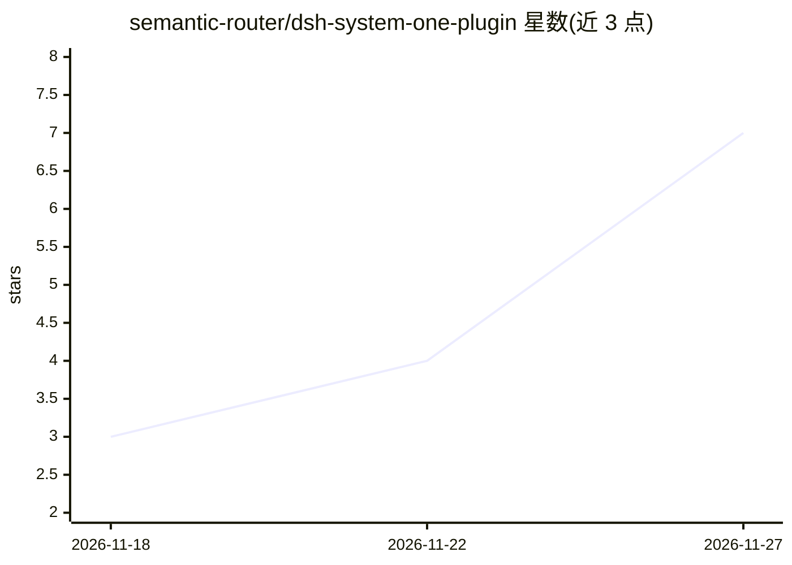

# semantic-router/dsh-system-one-plugin

⭐ 7 · JavaScript · Apache-2.0 · 推送 2026-11-20 · [GitHub](https://github.com/semantic-router/dsh-system-one-plugin) · [官网](https://app.vllm-sr.ai/#harness) · 组织维护

**给 DeepSeek Harness agent 加 System One 快速决策防护插件**

DeepSeek Harness 的插件（@vllm-sr/dsh），在 agent 循环中引入 System One 快速决策模型：对每个请求做 Triage 分类、工具调用前 Guard 风险询问、工具结果后 Shield 提示注入过滤与 Privacy 个人数据脱敏、回合结束时 Done-check 证据校验，并提供 system_one 与 system_one_screen 两个工具供 System Two 调用。默认模型设为 vllm-sr/auto，快速模型由 vLLM Semantic Router 服务。首次运行自动获取免费 key，仅限研究与评估用途，商业使用不被许可；需要 Node 24.9+。

## 筛选速览

| 维度 | 判定 | 备注 |
|---|---|---|
| AI 角色 | `ai-ecosystem` | LLM/agent 周边工具 |
| 许可风险 | `permissive` | Apache-2.0 |
| 部署形态 | `library` | 以包/库形式分发 |
| 模型依赖 | local-ok | 支持本地模型 |
| 硬件要求 | — | 无带数字的原话,不猜 |
| 安装摩擦 | `low` | 无编译、无系统依赖或容器化 |
| 成熟度 | — | 结构信号不足 |

## 能力要点

- 五类内置反射：Triage/Guard/Shield/Privacy/Done-check 覆盖请求、工具调用、结果与回合结束
- 支持 headless 与 CI 运行（VLLM_SR_API_KEY）
- System One 不可达时有 fallback 行为（guardOnError，默认 allow）
- 21 个真实会话的浏览器只读回放演示

## 适用场景

- 为 DeepSeek Harness agent 加上危险命令确认与提示注入过滤
- 在工具结果进入推理模型前脱敏个人数据
- 在 CI 中以 headless 方式运行带防护的 agent

## 场景标签

 · 领域:AI Agent 基础设施/安全防护

## 证据(README 行号)

> L5: <code>@vllm-sr/dsh</code> gives your DeepSeek Harness agent a System One: fast decision models that triage, guard, s
> L79: - **One router.** vLLM Semantic Router serves System One and routes System Two at

## 星数曲线

2026-11-18 3 → 2026-11-27 7（+4）

---
*卡片 v1 · prompt 1.4 · 生成 2026-11-21 · 置信度 high · 依据 README sha `f115c65ad821` · [字段定义](../../DATASET.md)*
