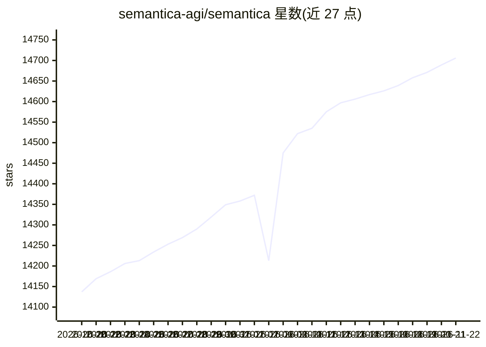

# semantica-agi/semantica

⭐ 14,706 · Python · MIT · 推送 2026-11-21 · [GitHub](https://github.com/semantica-agi/semantica) · [官网](https://getsemantica.ai) · 组织维护

**为 LLM 与 agent 提供可审计 Context Graph 的语义层基础设施**

定位为 LLM、向量库与 agent 框架之下的语义/上下文层：将企业数据摄入、解析、抽取（NER/关系/事件/三元组），经冲突检测与去重后构建携带业务含义的知识图谱与 Context Graph；图谱构建、推理与溯源层为确定性实现，不依赖 LLM。以决策记录为一等图节点，输出 W3C PROV-O 溯源与审计轨迹，支持 RDF 与 LPG 多后端存储及 OWL/SHACL/SKOS 本体治理。pip 安装，提供 CLI、REST API、MCP server 与 Python 库。面向 AI 平台团队、受监管行业企业与合规审计团队。

## 筛选速览

| 维度 | 判定 | 备注 |
|---|---|---|
| AI 角色 | `ai-ecosystem` | LLM/agent 周边工具 |
| 许可风险 | `permissive` | MIT |
| 部署形态 | `library` | 以包/库形式分发 |
| 模型依赖 | local-ok | 支持本地模型 |
| 硬件要求 | — | 无带数字的原话,不猜 |
| 安装摩擦 | `low` | 无编译、无系统依赖或容器化 |
| 成熟度 | — | 结构信号不足 |

## 动量与使用信号

- 维护:`active` — 距上次 push 0.9 天,年发版 24,128 位贡献者
- 涨星:近 1 天 **+23**(自 20261016 起算)
- 安装:pypi 包 `semantica` 月下载 14,741
- 平台:— · 协议:MCP / OLLAMA

## 能力要点

- 图谱构建、推理与溯源为确定性实现，LLM 可选且厂商中立（semantica.llms 支持多 provider）
- 决策记录为一等图节点，支持 record_decision/因果关联/先例搜索，导出 W3C PROV-O
- 多源数据摄入管道：NER/关系/事件抽取、冲突检测、语义去重与保留溯源的合并
- RDF（Oxigraph/Blazegraph/Jena/RDF4J）与 LPG（Neo4j/FalkorDB/AGE/Neptune）多后端可切换

## 适用场景

- 为 agent 提供结构化、可查询的上下文记忆层
- 受监管行业记录并解释 AI 决策以供审计
- 把数据仓库/Databricks/Snowflake 中的表构建为带血缘的知识图谱
- 对多源企业数据做实体消歧与冲突检测

## 场景标签

`Agent 记忆` `知识图谱` `RAG` `文档解析` · 领域:Agent 开发

## 证据(README 行号)

> L54: Semantica is the semantic/context layer underneath your LLM, vector store, and agent framework: deterministic infra
> L63: - **AI/ML platform teams** shipping agents that make consequential decisions and need structured, queryable context
> L84: - **Drop-in Integrations:** Agno, CrewAI, and LangChain support, a full MCP server, a CLI, a REST API, and plugins 

## 星数曲线

2026-10-20 14,137 → 2026-11-22 14,706（+569）

---
*卡片 v1 · prompt 1.4 · 生成 2026-11-22 · 置信度 mid · 依据 README sha `9144a942f18d` · [字段定义](../../DATASET.md)*
