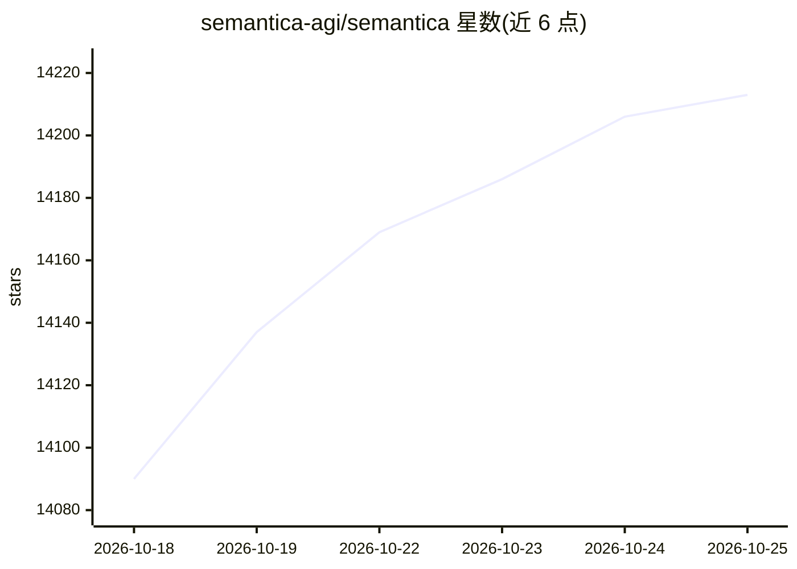

# semantica-agi/semantica

⭐ 14,234 · Python · MIT · 推送 2026-10-25 · [GitHub](https://github.com/semantica-agi/semantica) · [官网](https://getsemantica.ai) · 组织维护

**为 AI 系统提供上下文图谱与决策溯源的开源基础设施**

以 Python 库形式提供的语义/上下文层：摄取企业数据后抽取实体与关系，构建 Context Graph 与知识图谱，并支持 Rete/Datalog/SPARQL 确定性推理、W3C PROV-O 溯源、SHACL/OWL 本体治理与决策记录。图谱构建、推理与溯源不依赖 LLM，LLM 调用为可选项。图存储支持 RDF 与 LPG 多后端互换，提供 REST API、MCP server、CLI 与可视化界面。面向 AI/ML 平台团队、企业数据团队与受监管行业的合规/审计场景。

## 筛选速览

| 维度 | 判定 | 备注 |
|---|---|---|
| AI 角色 | `ai-native` | 本体是模型或模型工具 |
| 许可风险 | `permissive` | MIT |
| 部署形态 | `library` | 以包/库形式分发 |
| 模型依赖 | — | README 未给出锁定关系 |
| 硬件要求 | — | 无带数字的原话,不猜 |
| 安装摩擦 | `low` | 无编译、无系统依赖或容器化 |
| 成熟度 | — | 结构信号不足 |

## 动量与使用信号

- 维护:`active` — 距上次 push 0.9 天,年发版 24,128 位贡献者
- 涨星:近 1 天 **+23**(自 20261016 起算)
- 安装:pypi 包 `semantica` 月下载 14,741
- 平台:— · 协议:MCP / OLLAMA

## 能力要点

- 每个事实带 W3C PROV-O 溯源，决策作为一等图节点可查询
- 确定性推理引擎（前向链、Rete、Datalog、SPARQL），图谱构建无需 LLM
- 多源摄取连接器：Databricks、Snowflake、SAP、Kafka、Git 等
- RDF（Oxigraph、Blazegraph 等）与 LPG（Neo4j、FalkorDB 等）存储可互换

## 适用场景

- 为 agent 提供结构化、可查询的上下文记忆层
- 把数据仓库中的表变成带血缘的知识图谱
- 为受监管行业的 AI 决策提供可审计的溯源记录
- 从多源数据构建知识图谱并检测冲突事实

## 场景标签

`Agent 记忆` `知识图谱` · 领域:Agent 开发

## 证据(README 行号)

> L54: Semantica is the semantic/context layer underneath your LLM, vector store, and agent framework: deterministic infra
> L74: - **Context Graphs:** A structured, queryable graph of everything your agent knows, decides, and reasons about
> L101: Semantica complements your existing stack rather than replacing it. Keep your LLM, vector store, and agent framewo

## 星数曲线

2026-10-18 14,090 → 2026-10-25 14,213（+123）

---
*卡片 v1 · prompt 1.4 · 生成 2026-10-18 · 置信度 high · 依据 README sha `3b2ade90533f` · [字段定义](../../DATASET.md)*
