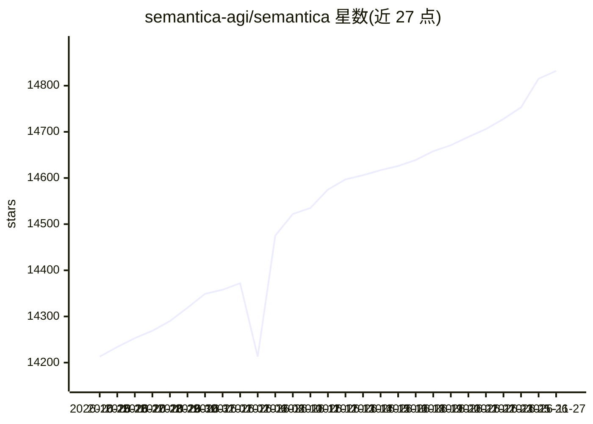

# semantica-agi/semantica

⭐ 14,832 · Python · MIT · 推送 2026-11-26 · [GitHub](https://github.com/semantica-agi/semantica) · [官网](https://getsemantica.ai) · 组织维护

**为受监管行业 AI 提供图谱化语义层与决策溯源**

面向 LLM 与 agent 框架下方的语义/上下文层：从文件、数据库、数据平台（Databricks/Snowflake/SAP）等多源摄取数据，经解析、实体感知分块、NER/关系/事件抽取、冲突检测与去重后构建 Context Graph 与知识图谱，支持 RDF 与属性图多种存储后端互换。本体治理用 OWL/SHACL/SKOS，推理引擎为确定性规则（前向链、Rete、Datalog、SPARQL），每条事实带 W3C PROV-O 溯源；决策记录为一等图节点可导出供审计。图构建与推理不依赖 LLM，LLM 调用可选且供应商中立。面向 AI/ML 平台团队、企业数据团队与合规审计团队，Python 3.11.5+ 可用。

## 筛选速览

| 维度 | 判定 | 备注 |
|---|---|---|
| AI 角色 | `ai-ecosystem` | LLM/agent 周边工具 |
| 许可风险 | `permissive` | MIT |
| 部署形态 | `library` | 以包/库形式分发 |
| 模型依赖 | local-ok | 支持本地模型 |
| 硬件要求 | — | 无带数字的原话,不猜 |
| 安装摩擦 | `low` | 无编译、无系统依赖或容器化 |
| 成熟度 | — | 结构信号不足 |

## 动量与使用信号

- 维护:`active` — 距上次 push 0.9 天,年发版 24,128 位贡献者
- 涨星:近 1 天 **+23**(自 20261016 起算)
- 安装:pypi 包 `semantica` 月下载 14,741
- 平台:— · 协议:MCP / OLLAMA

## 能力要点

- 确定性推理引擎（前向链、Rete、Datalog、SPARQL），构建与推理无需 LLM
- 每条事实带 W3C PROV-O 溯源，决策记录为一等可查询图节点
- 多源摄取管线含冲突检测、语义去重与保持溯源的合并
- RDF 与 LPG 多后端存储可互换，提供 MCP server、REST API、CLI 与 LangChain/CrewAI/Agno 集成

## 适用场景

- 为 agent 构建可查询、可追溯的结构化上下文与决策记忆
- 把湖仓/数仓中已有的表治理为带血缘的知识图谱
- 合规审计场景回答'AI 为什么做这个决策'并导出监管格式
- 多源脏数据建图时自动标记冲突事实并合并重复实体

## 场景标签

`知识图谱` `Agent 记忆` · 领域:Agent 开发

## 证据(README 行号)

> L54: Semantica is the semantic/context layer underneath your LLM, vector store, and agent framework: deterministic infra
> L82: - **Polyglot Graph Storage:** RDF (Oxigraph, Blazegraph, Jena, RDF4J) and Labeled Property Graphs (Neo4j, FalkorDB,
> L101: Semantica complements your existing stack rather than replacing it. Keep your LLM, vector store, and agent framewo

## 星数曲线

2026-10-25 14,213 → 2026-11-27 14,832（+619）

---
*卡片 v1 · prompt 1.4 · 生成 2026-11-24 · 置信度 high · 依据 README sha `694012bd701d` · [字段定义](../../DATASET.md)*
