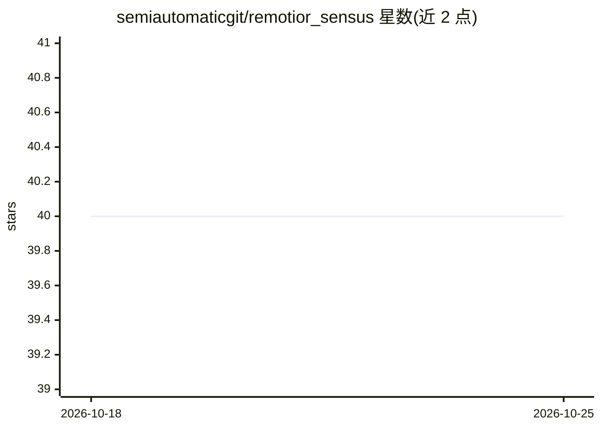

# semiautomaticgit/remotior_sensus

⭐ 40 · Python · NOASSERTION · 推送 2026-10-07 · [GitHub](https://github.com/semiautomaticgit/remotior_sensus) · [官网](https://fromgistors.blogspot.com/p/remotior-sensus.html) · 个人维护

**遥感影像与 GIS 数据处理的 Python 包，支持机器学习分类**

由 Luca Congedo 开发的 Python 包，覆盖遥感数据全流程：Landsat 与 Sentinel-2 影像搜索下载、预处理、基于机器学习（可选 PyTorch/scikit-learn）的土地覆盖分类，以及 GIS 数据管理与空间分析。核心机制包括 BandSet 波段目录对象（按中心波长等属性引用波段）、基于栅格分块与多线程的并行处理、动态重投影。基本依赖 GDAL/NumPy/SciPy，推荐 Conda 安装。README 自述仍处于早期开发阶段，工具与 API 可能变更。

## 筛选速览

| 维度 | 判定 | 备注 |
|---|---|---|
| AI 角色 | `ai-native` | 本体是模型或模型工具 |
| 许可风险 | `none` | NOASSERTION |
| 部署形态 | `library` | 以包/库形式分发 |
| 模型依赖 | — | README 未给出锁定关系 |
| 硬件要求 | — | 无带数字的原话,不猜 |
| 安装摩擦 | `medium` | 含编译或系统依赖之一 |
| 成熟度 | `idea` | |

## 能力要点

- Landsat 与 Sentinel-2 影像搜索、下载与预处理
- 基于 PyTorch/scikit-learn 的机器学习土地覆盖分类
- BandSet 波段目录对象，按中心波长等属性引用波段
- 栅格分块多线程并行处理与动态重投影

## 适用场景

- 下载并预处理 Landsat/Sentinel-2 卫星影像
- 用机器学习做土地覆盖分类
- 管理多波段栅格数据并进行主成分分析、镶嵌与波段计算

## 场景标签

`图像视频处理` · 领域:感知与多模态

## 证据(README 行号)

> L33: Remotior Sensus (which is Latin for "a more remote sense") is a Python package
> L54: - **Search and Download** of remote sensing data such as Landsat and Sentinel-2.
> L95: Remotior Sensus optional dependencies are `PyTorch <https://pytorch.org/>`_
> L98: to allow for land cover classification through machine learning.

## 星数曲线

2026-10-18 40 → 2026-10-25 40（+0）

---
*卡片 v1 · prompt 1.4 · 生成 2026-10-25 · 置信度 high · 依据 README sha `a023b32002ca` · [字段定义](../../DATASET.md)*
