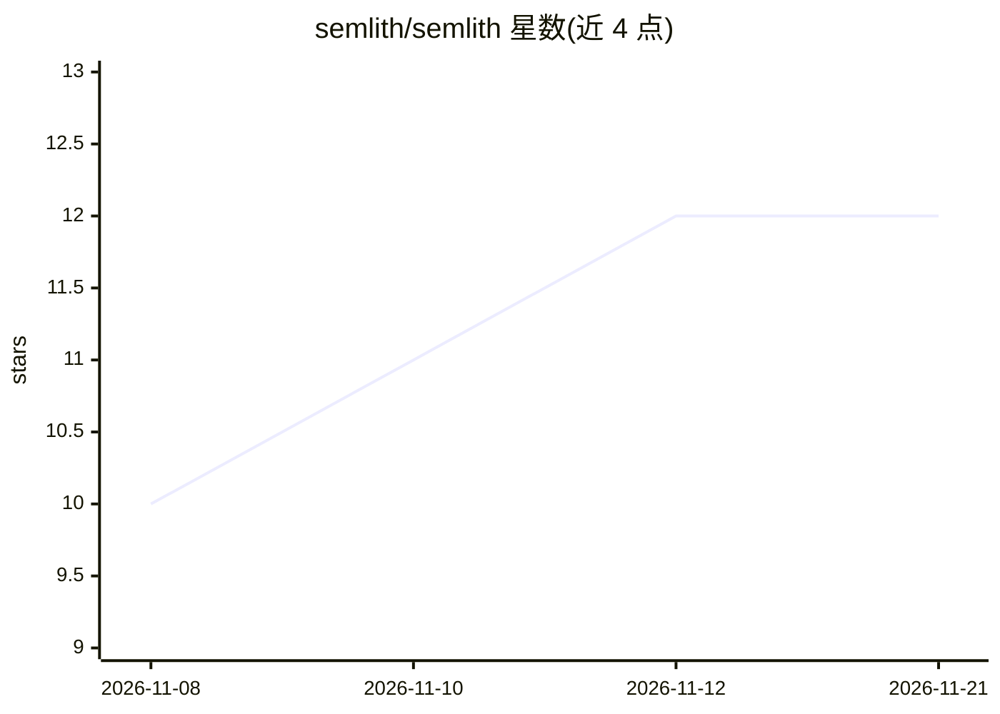

# semlith/semlith

⭐ 12 · Rust · Apache-2.0 · 推送 2026-11-19 · [GitHub](https://github.com/semlith/semlith) · [官网](https://semlith.com) · 个人维护

**为 AI agent 提供本地代码与文档搜索的 MCP 服务**

单二进制工具，将代码仓库、PDF、Office 文档、笔记本和 Markdown 索引为本地搜索库，通过 MCP 协议（stdio 与 HTTP）向 agent 客户端提供 16 个检索工具。查询同时走向量索引与关键词索引并融合排序，同一次解析建立符号调用图；文件保存时由 watcher 重新嵌入。默认仅绑定 127.0.0.1，无查询时网络请求，支持 --airgap；嵌入模型约 52 MB 经 ONNX Runtime 运行，Apple silicon 与 GPU 可作加速通道。

## 筛选速览

| 维度 | 判定 | 备注 |
|---|---|---|
| AI 角色 | `ai-ecosystem` | LLM/agent 周边工具 |
| 许可风险 | `permissive` | Apache-2.0 |
| 部署形态 | `desktop` | 安装包/桌面程序 |
| 模型依赖 | local-ok | 支持本地模型 |
| 硬件要求 | — | 无带数字的原话,不猜 |
| 安装摩擦 | `medium` | 含编译或系统依赖之一 |
| 成熟度 | — | 结构信号不足 |

## 能力要点

- 混合检索：向量索引与关键词索引融合排序，命中标注来源列表
- 同一遍解析构建代码图：定义/调用/导入为节点与边，46 种语言带边
- MCP 服务器提供 8-16 个工具，semlith setup 自动注册到 agent 客户端
- 本地优先：查询时无网络、无 API key，门户仅绑定 127.0.0.1 并支持 --airgap

## 适用场景

- 让 coding agent 在大型代码库中定位相关代码片段而非整文件阅读
- 把 PDF、Word 等文档纳入 agent 可检索的知识范围
- 查询符号的调用者、影响面与两符号间的连接路径
- 离线/隔离环境下为 agent 提供本地检索服务

## 场景标签

`语义搜索` · 领域:知识与检索

## 证据(README 行号)

> L42: - **Made for agents.** An MCP server with eight tools listed by default and
> L157: `semlith setup` registers the MCP server at user scope in each installed client
> L166: `semlith mcp` serves MCP over stdio, and the daemon serves the same tools over

## 星数曲线

2026-11-08 10 → 2026-11-21 12（+2）

---
*卡片 v1 · prompt 1.4 · 生成 2026-11-18 · 置信度 high · 依据 README sha `95d7cdc87e09` · [字段定义](../../DATASET.md)*
