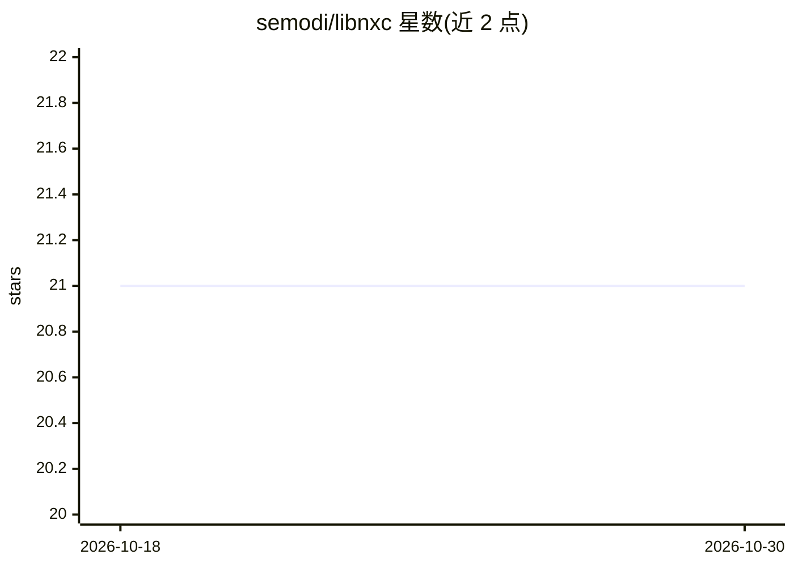

# semodi/libnxc

⭐ 21 · C++ · MPL-2.0 · 推送 2026-10-14 · [GitHub](https://github.com/semodi/libnxc) · [官网](https://libnxc.readthedocs.io/en/latest/) · 组织维护

**在 DFT 电子结构代码中调用机器学习交换关联泛函的 C++/Python 库**

Libnxc 提供 C++ 库、Fortran 绑定与 Python 实现（pylibnxc），用于在密度泛函理论计算中使用机器学习（神经网络）交换关联泛函，API 模仿 Libxc 以便集成到电子结构代码。机制上读取 TorchScript 序列化的 PyTorch 模型作为黑盒泛函求值器，支持 LDA/GGA/metaGGA 及自定义模型，可经 MPI 多进程与 CUDA 在 GPU 上推理；可与 PySCF 两行代码集成，或通过链接 Libxc 使 Quantum Espresso、CP2K 等代码调用。注意：README 声明本项目已被 marivifsSBU/libnxc 取代；经 Libxc 方式仅支持格点泛函，且部分代码未经修改时 NN 泛函求值可能显著变慢。

## 筛选速览

| 维度 | 判定 | 备注 |
|---|---|---|
| AI 角色 | `ai-ecosystem` | LLM/agent 周边工具 |
| 许可风险 | `permissive` | MPL-2.0 |
| 部署形态 | `library` | 以包/库形式分发 |
| 模型依赖 | — | README 未给出锁定关系 |
| 硬件要求 | — | 无带数字的原话,不猜 |
| 安装摩擦 | `medium` | 含编译或系统依赖之一 |
| 成熟度 | — | 结构信号不足 |

## 能力要点

- 以 TorchScript 序列化 PyTorch 模型作为泛函黑盒，支持自定义模型无需重编译
- C++/Fortran/Python 三种实现，API 模仿 Libxc 便于集成电子结构代码
- 支持 MPI 多进程与 CUDA GPU 推理
- 内置 Nagai 等 2020 年论文提出的 NN-LDA/GGA/metaGGA 泛函及 PBE/SCAN 拟合泛函

## 适用场景

- 在 PySCF 等 DFT 代码中把交换关联泛函替换为神经网络泛函做 SCF 计算
- 快速实验自定义机器学习泛函（plug-and-play）
- 通过链接 Libxc 让 Quantum Espresso、CP2K 等现有代码访问机器学习泛函

## 场景标签

`科研工具` · 领域:学习与行业

## 证据(README 行号)

> L9: Libnxc is a libary to use **machine learned** exchange-correlation functionals for density functional theory.
> L17:  1. The model has to be implemented in PyTorch and serialized into a TorchScript model (e.g. with ``torch.jit.trace

## 星数曲线

2026-10-18 21 → 2026-10-30 21（+0）

---
*卡片 v1 · prompt 1.4 · 生成 2026-10-28 · 置信度 high · 依据 README sha `814912f028a2` · [字段定义](../../DATASET.md)*
