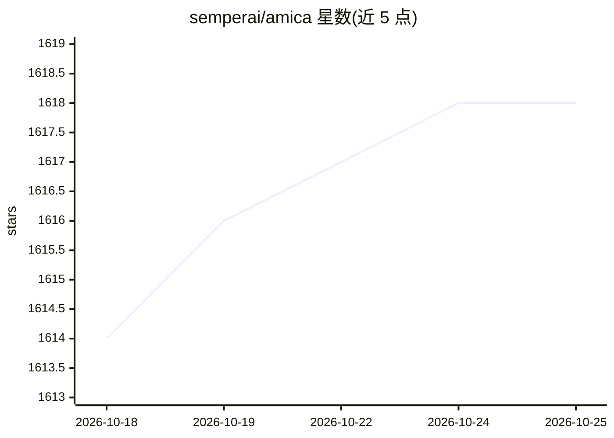

# semperai/amica

⭐ 1,618 · TypeScript · MIT · 推送 2026-09-22 · [GitHub](https://github.com/semperai/amica) · [官网](https://heyamica.com) · 组织维护

**与可定制 3D 角色语音对话的开源聊天界面**

基于 Web 的 3D 虚拟角色对话应用：导入 VRM 模型，通过 three.js 与 @pixiv/three-vrm 渲染角色，用 Whisper 做语音识别、Silero VAD 做活动检测，聊天后端可接 Llama.cpp server、Ollama、OpenRouter、ChatGPT API 等，TTS 支持 Eleven Labs、OpenAI、Coqui 等，并带情感引擎使角色表达情绪。安装方式为 git clone 源码加 npm install，以 npm run dev 启动网页或用 Tauri 构建桌面应用，配置集中在 .env.local。项目为 Pixiv ChatVRM 的 fork，主体 MIT 许可。

## 筛选速览

| 维度 | 判定 | 备注 |
|---|---|---|
| AI 角色 | `ai-native` | 本体是模型或模型工具 |
| 许可风险 | `permissive` | MIT |
| 部署形态 | `library` | 以包/库形式分发 |
| 模型依赖 | local-ok | 支持本地模型 |
| 硬件要求 | — | 无带数字的原话,不猜 |
| 安装摩擦 | `low` | 无编译、无系统依赖或容器化 |
| 成熟度 | — | 结构信号不足 |

## 能力要点

- VRM 3D 角色导入与 three.js 渲染
- Whisper 语音识别与 Silero VAD 活动检测
- 聊天后端支持 Ollama/Llama.cpp/OpenRouter/ChatGPT API 等多种
- TTS 支持 Eleven Labs/OpenAI/Coqui/RVC 等，含情感引擎

## 适用场景

- 与自定义 3D 角色进行语音对话
- 本地或云端 LLM 后端驱动的虚拟助手/伴侣
- 用 Tauri 构建桌面端虚拟角色应用

## 场景标签

`语音 Agent` `AI 助手` · 领域:对话与助手

## 证据(README 行号)

> L11: Amica allows you to converse with highly customizable 3D characters that can communicate via natural voice chat and
> L33: - Speech recognition
> L37: - ChatBot

## 星数曲线

2026-10-18 1,614 → 2026-10-25 1,618（+4）

---
*卡片 v1 · prompt 1.4 · 生成 2026-10-21 · 置信度 high · 依据 README sha `6b633260bbe7` · [字段定义](../../DATASET.md)*
