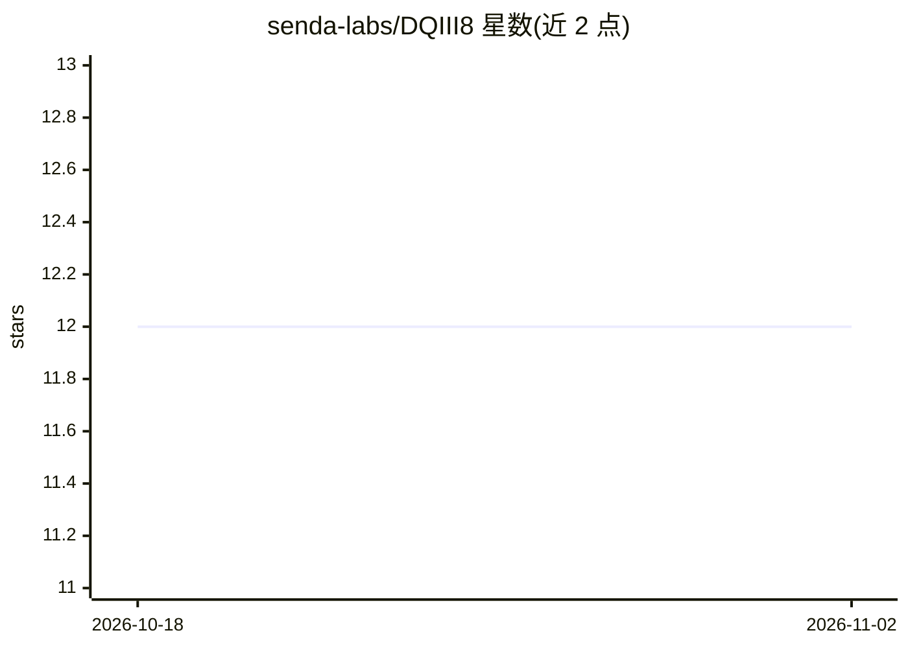

# senda-labs/DQIII8

⭐ 12 · Python · MIT · 推送 2026-09-14 · [GitHub](https://github.com/senda-labs/DQIII8) · 组织维护

**面向 SSH VPS 的成本优先多智能体编排引擎**

面向 Ubuntu 22.04/24.04 VPS 部署的自主 AI 编排引擎，通过分层路由管道将请求按 local→free cloud→paid 顺序逐级尝试最便宜的可用模型，失败时按 ollama→groq→nim→github 顺序回退。深度集成 Claude Code（15 个生命周期钩子、26 个技能、17 个专家 agent），状态存储于本地 SQLite（59 表），含权限分析器、三段式意图路由、Telegram 与 CLI 入口。定位为参考实现，安装经 git clone + install.sh 完成；最小可用仅需免费的 Groq API key，Ollama 本地模型与知识库均为可选。

## 筛选速览

| 维度 | 判定 | 备注 |
|---|---|---|
| AI 角色 | `ai-ecosystem` | LLM/agent 周边工具 |
| 许可风险 | `permissive` | MIT |
| 部署形态 | `library` | 以包/库形式分发 |
| 模型依赖 | local-ok | 支持本地模型 |
| 硬件要求 | — | 无带数字的原话,不猜 |
| 安装摩擦 | `low` | 无编译、无系统依赖或容器化 |
| 成熟度 | — | 结构信号不足 |

## 能力要点

- 分层成本优先路由：本地 Ollama → 免费 Groq/NIM/GitHub Models → 付费 Anthropic 逐级升级
- Claude Code 集成：15 个生命周期钩子、26 个技能、17 个专家 agent
- pre_tool_use 钩子内 PermissionAnalyzer 决定 APPROVE/DENY/ESCALATE 的确定性权限
- SQLite 状态引擎（59 表 29 视图），无外部状态存储

## 适用场景

- 在 VPS 上以最低成本运行多模型 agent 任务
- 通过 Telegram 或 CLI 触发自主任务编排
- 参考其路由与钩子架构构建自己的多模型系统

## 场景标签

`多智能体` `编码 Agent` `模型网关` · 领域:Agent 开发

## 证据(README 行号)

> L10: **DQIII8 is an autonomous AI orchestration engine built for SSH-only VPS deployment.**
> L25: - **Cost-first routing** — pick the cheapest tier that can do the job; escalate only on explicit task-type match or
> L58: ### Cost-first router — `bin/core/openrouter_wrapper.py`

## 星数曲线

2026-10-18 12 → 2026-11-02 12（+0）

---
*卡片 v1 · prompt 1.4 · 生成 2026-11-01 · 置信度 mid · 依据 README sha `434a23755e1c` · [字段定义](../../DATASET.md)*
