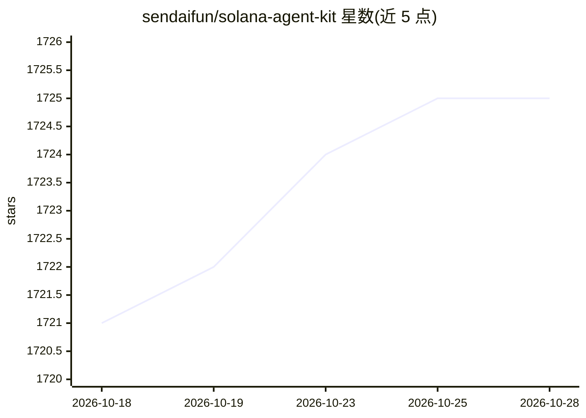

# sendaifun/solana-agent-kit

⭐ 1,728 · TypeScript · Apache-2.0 · 推送 2026-05-14 · [GitHub](https://github.com/sendaifun/solana-agent-kit) · [官网](https://kit.sendai.fun) · 组织维护

**将 AI agent 接入 Solana 协议的 TypeScript 工具包**

开源工具包，让使用任意模型训练的 AI agent 自主执行 60+ 种 Solana 链上操作：代币部署与转账、NFT 创建与上架（3.Land/Metaplex）、Jupiter/Raydium/Orca 等 DeFi 协议交互、质押、借贷、永续交易、跨链桥（Wormhole/deBridge）、Blinks 与行情数据（CoinGecko/Pyth）。提供 LangChain 与 Vercel AI SDK 两套工具封装（createLangchainTools/createVercelAITools），核心包加五个可选插件（token/NFT/DeFi/misc/blinks）通过 npm 安装。面向在 Solana 上构建 agent 的开发者。

## 筛选速览

| 维度 | 判定 | 备注 |
|---|---|---|
| AI 角色 | `ai-ecosystem` | LLM/agent 周边工具 |
| 许可风险 | `permissive` | Apache-2.0 |
| 部署形态 | `library` | 以包/库形式分发 |
| 模型依赖 | — | README 未给出锁定关系 |
| 硬件要求 | — | 无带数字的原话,不猜 |
| 安装摩擦 | `low` | 无编译、无系统依赖或容器化 |
| 成熟度 | — | 结构信号不足 |

## 能力要点

- 60+ 种 Solana 链上操作：代币/NFT/DeFi/跨链桥/Blinks
- LangChain 与 Vercel AI SDK 双集成，提供即用工具封装
- 插件化架构：token/NFT/DeFi/misc/blinks 五个插件按需安装
- 对接 Jupiter、Raydium、Orca、Drift、Wormhole 等 Solana 生态协议

## 适用场景

- 让 AI agent 自主执行 Solana 代币交易、质押与借贷
- 通过自然语言驱动链上 NFT 创建与上架
- 构建 Solana DeFi 自动化 agent（永续交易、金库管理）

## 场景标签

`Agent 框架` · 领域:Agent 开发

## 证据(README 行号)

> L12: An open-source toolkit for connecting AI agents to Solana protocols. Now, any agent, using any model can autonomous
> L83: - **LangChain Integration**

## 星数曲线

2026-10-18 1,721 → 2026-10-28 1,725（+4）

---
*卡片 v1 · prompt 1.4 · 生成 2026-10-21 · 置信度 high · 依据 README sha `294d903a3abd` · [字段定义](../../DATASET.md)*
