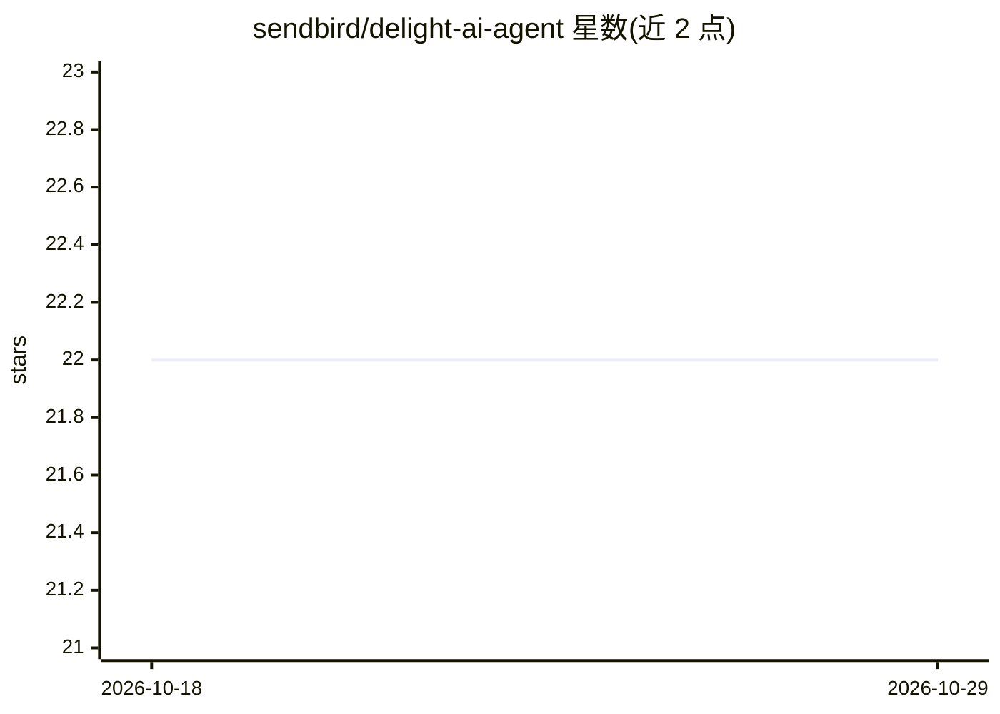

# sendbird/delight-ai-agent

⭐ 22 · Swift · 推送 2026-10-21 · [GitHub](https://github.com/sendbird/delight-ai-agent) · [官网](https://sendbird.com/ai-agent) · 组织维护

**Sendbird Delight AI agent 的客户端集成 SDK 与示例工程**

Sendbird 公司的 Delight AI agent 产品配套仓库：提供 JavaScript（React/CDN）、iOS、Android 平台的集成文档与可运行的示例工程，通过 Delight AI dashboard 获取 Application ID 与 AI Agent ID 后在应用内初始化 AI agent。功能由云端服务实现：全渠道支持（SMS/邮件/WhatsApp/应用内聊天等）、跨渠道上下文保持、主动触达，以及与 Salesforce、Zendesk 等系统的集成。仓库内容为客户端接入与示例代码，MIT 许可。

## 筛选速览

| 维度 | 判定 | 备注 |
|---|---|---|
| AI 角色 | `ai-ecosystem` | LLM/agent 周边工具 |
| 许可风险 | `none` | — |
| 部署形态 | `library` | 以包/库形式分发 |
| 模型依赖 | — | README 未给出锁定关系 |
| 硬件要求 | — | 无带数字的原话,不猜 |
| 安装摩擦 | `low` | 无编译、无系统依赖或容器化 |
| 成熟度 | — | 结构信号不足 |

## 能力要点

- 覆盖 JavaScript（React/CDN）、iOS、Android 三端的集成指南与示例
- 示例包含用户认证、会话处理、上下文配置与消息控件演示
- 通过 Delight AI dashboard 的 Application ID / Agent ID 初始化

## 适用场景

- 在自己的 App 或网站中接入 Delight AI 客服 agent
- 参考 React/CDN 示例工程做本地开发调试
- 查阅各平台 SDK 的集成文档

## 场景标签

`聊天机器人` · 领域:对话与助手

## 证据(README 行号)

> L26: 3. **Integrate SDK**: Depending on your platform (iOS, Android, Web), integrate the appropriate Delight AI agent SD
> L34: This repository contains platform-specific implementations and customer guides for the Delight AI agent:

## 星数曲线

2026-10-18 22 → 2026-10-29 22（+0）

---
*卡片 v1 · prompt 1.4 · 生成 2026-10-27 · 置信度 high · 依据 README sha `1c4886359364` · [字段定义](../../DATASET.md)*
