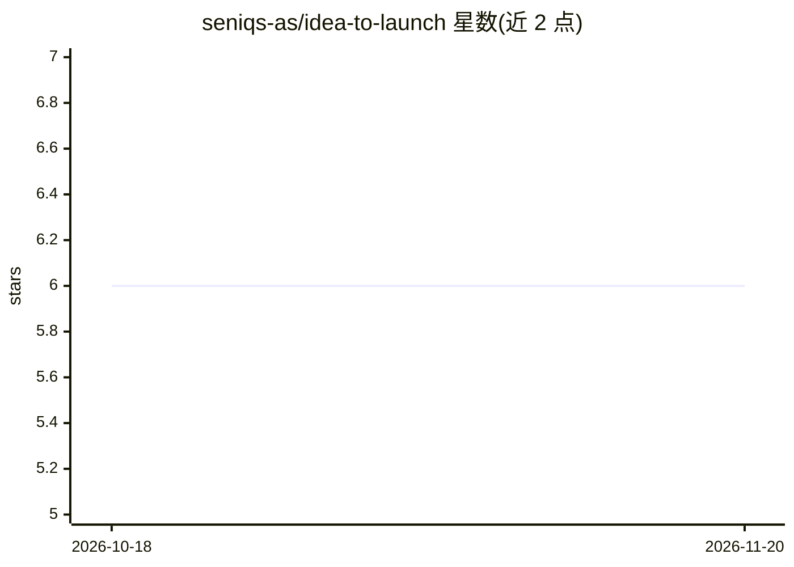

# seniqs-as/idea-to-launch

⭐ 6 · MIT · 推送 2026-10-14 · [GitHub](https://github.com/seniqs-as/idea-to-launch) · [官网](https://seniqs.no) · 组织维护

**结构化访谈式 AI prompt/skill：从模糊想法收敛到已验证的项目方案**

仓库内容是一份 prompt 与打包成 SKILL.md 格式的 Claude skill，把 AI 助手变成项目立项访谈伙伴：八个阶段依次覆盖背景、项目类别、兴趣/预算/技能探索、打分比较收敛到单一项目、MVP 定义、竞品清单（带链接与定价）、名称与域名可用性检查、市场分析与 30/60/90 天营销计划。原则包括一次只问一个问题、假设需标明、市场结论须引用来源。仓库另含精简版 prompt 与各平台使用指南，MIT 许可。

## 筛选速览

| 维度 | 判定 | 备注 |
|---|---|---|
| AI 角色 | `ai-knowledge` | 知识聚合/清单类 |
| 许可风险 | `permissive` | MIT |
| 部署形态 | `None` |  |
| 模型依赖 | — | README 未给出锁定关系 |
| 硬件要求 | — | 无带数字的原话,不猜 |
| 安装摩擦 | `low` | 无编译、无系统依赖或容器化 |
| 成熟度 | — | 结构信号不足 |

## 能力要点

- 八阶段结构化访谈流程，每阶段结束有确认与回溯
- 竞品分析要求给出真实命名竞品、链接与定价（依赖联网搜索）
- 同一内容提供完整版/精简版 prompt 与 SKILL.md 三种形态
- 兼容任意接受 system prompt 的助手与技能型 agent 工具

## 适用场景

- 在动手开发前通过与 AI 访谈筛选并验证一个项目想法
- 生成包含 MVP 定义、竞品对比与营销计划的项目立项文档
- 为 Custom GPT / Gemini Gem / Claude Code 配置立项访谈技能

## 场景标签

`提示工程` `AI 助手` · 领域:Agent 开发

## 证据(README 行号)

> L7: `idea-to-launch` is a prompt (and a ready-to-install Claude skill) that turns an AI assistant into a project ideatio
> L49: prompts/project_ideation.md          Full prompt, works with any AI assistant
> L51: skills/idea-to-launch/SKILL.md       Same content packaged as a skill (SKILL.md format)

## 星数曲线

2026-10-18 6 → 2026-11-20 6（+0）

---
*卡片 v1 · prompt 1.4 · 生成 2026-11-20 · 置信度 high · 依据 README sha `3ffb7c42444a` · [字段定义](../../DATASET.md)*
